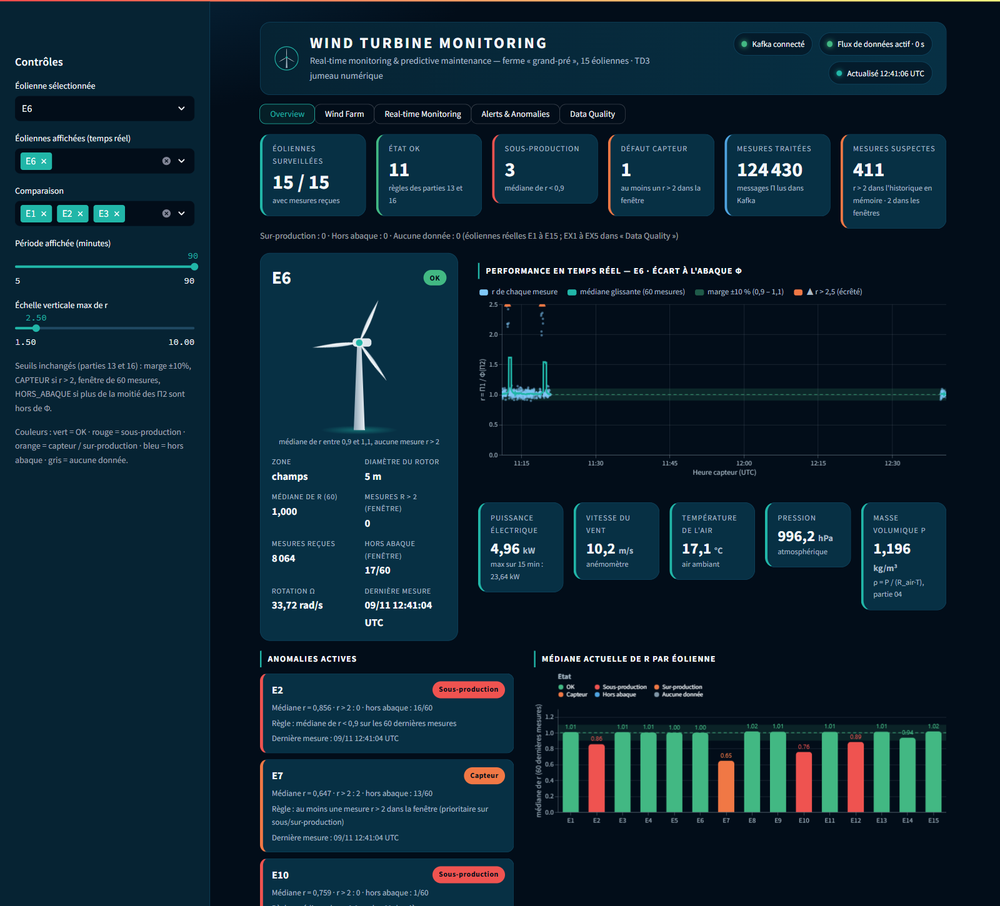
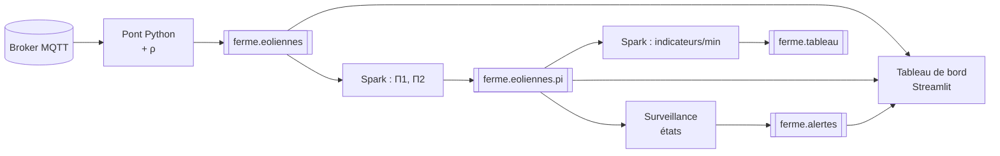
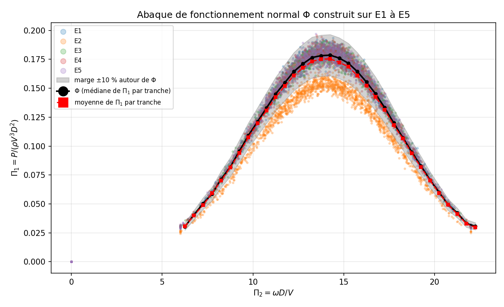
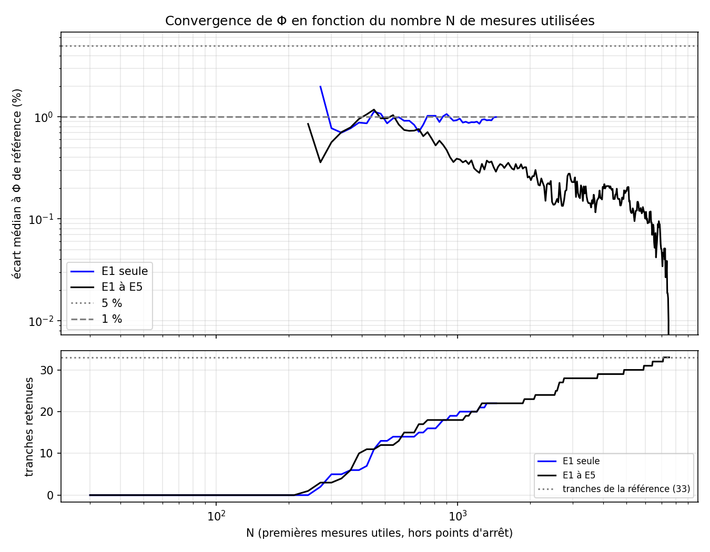

# Wind Turbine Monitoring

Surveillance temps réel d'une ferme de 15 éoliennes : **MQTT → Kafka → Spark Structured Streaming → détection
d'anomalies → tableau de bord Streamlit**, avec un modèle de fonctionnement normal construit par analyse
dimensionnelle (théorème de Vaschy-Buckingham).

> *Real-time wind turbine monitoring: an MQTT feed is bridged into Kafka, Spark computes two dimensionless groups
> (Π1, Π2) per measurement, each turbine is compared to a reference curve Φ learned on healthy turbines, and
> anomalies (under-production, sensor faults, missing data) are raised in Kafka and shown on a live dashboard.*

Projet réalisé dans le cadre du TD3 « Une ferme éolienne connectée » — Master 2 Informatique, Le Mans Université.



## Fonctionnalités

- **Ingestion** : pont MQTT (WebSocket + TLS) → topic Kafka `ferme.eoliennes`, arrêt propre sans perte
  (`acks=all`, producteur idempotent), enrichissement par la masse volumique de l'air ρ.
- **Traitement en flux** : Spark Structured Streaming calcule Π1 = P/(ρV³D²) et Π2 = ωD/V pour chaque mesure,
  puis des indicateurs par éolienne et par minute (fenêtres sur l'heure capteur, watermark de 2 min).
- **Modèle** : abaque Φ(Π2) = médiane de Π1 par tranche de Π2, appris sur les éoliennes saines E1 à E5.
- **Détection** : écart r = Π1/Φ(Π2) ; états `OK`, `SOUS_PRODUCTION`, `SUR_PRODUCTION`, `CAPTEUR`,
  `HORS_ABAQUE` sur une fenêtre glissante de 60 mesures ; une alerte Kafka par changement d'état.
- **Qualité des données** : simulation de mesures perdues, de champs absents et de silences (EX1..EX5) et
  indicateurs de fraîcheur / complétude.
- **Tableau de bord** : 5 vues (Overview, Wind Farm, Real-time Monitoring, Alerts & Anomalies, Data Quality),
  rafraîchies toutes les 5 s, entièrement alimentées par Kafka.

## Architecture



Détails (topics, formats des messages, règles d'état, organisation du code) : [docs/architecture.md](docs/architecture.md).
Guide du tableau de bord : [docs/dashboard.md](docs/dashboard.md).

## Stack

Python 3.12 · Apache Kafka 3.9 (KRaft) · PySpark 4.0 · confluent-kafka · paho-mqtt 2 · pandas · Streamlit 1.40 /
Altair · Docker Compose · Kafka UI.

## Démarrage rapide

Prérequis : Docker Desktop (Compose v2), ~3 Go pour l'image, accès sortant HTTPS (443) au broker MQTT.

```bash
git clone https://github.com/Fareskhleifi/wind-turbine-monitoring.git
cd wind-turbine-monitoring
cp .env.exemple .env           # renseigner MQTT_IDENTIFIANT et MQTT_MDP
docker compose up -d --build   # kafka, kafka-init (crée les 4 topics), kafka-ui, app
```

| Service | URL |
|---|---|
| Tableau de bord | <http://localhost:8501> |
| Kafka UI | <http://localhost:8080> |
| Spark UI | <http://localhost:4040> (job 12), <http://localhost:4041> (job 17) |

Puis, dans le conteneur `app` (`docker compose exec app bash`), un terminal par processus continu :

```bash
python tests/test_mqtt_connection.py 10      # diagnostic DNS / TCP / TLS / WebSocket / authentification
python scripts/04_pont_masse_volumique.py    # 1. pont MQTT -> Kafka avec ρ        (continu)
python scripts/12_spark_pi.py                # 2. Spark : Π1, Π2                  (continu)
python scripts/16_surveiller_capteur.py      # 3. états + alertes                 (continu)
python scripts/17_spark_indicateurs.py       # 4. indicateurs par minute          (continu)
streamlit run scripts/15_tableau_r.py --server.port 8501 --server.address 0.0.0.0   # 5. tableau de bord
```

> Sous Git Bash (Windows), préfixer les commandes `docker compose exec` par `MSYS_NO_PATHCONV=1`.
> Sur une installation antérieure, créer `ferme.eoliennes.pi` à la main ou relancer `docker compose up kafka-init`.

## Scripts (une partie de l'énoncé par script)

| Script | Partie | Rôle | Sortie |
|---|---|---|---|
| `01_mqtt.py [durée]` | 01 | écoute le broker | `data/topics.jsonl`, `data/mesures.jsonl` |
| `02_pont_kafka.py` | 02 | pont MQTT → Kafka (message intact) | `ferme.eoliennes` |
| `03_consumer.py` | 03 | relit Kafka, trace P(V) de E1 et E2 | `puissance_vent.png` |
| `04_pont_masse_volumique.py` | 04 | pont avec ajout de ρ | `ferme.eoliennes` |
| `08_phi_tracer.py` | 08 | nuage Π1(Π2) de E1..E5 | `pi1_pi2.png` |
| `10_phi_construire.py` | 10 | construit l'abaque Φ | `phi.json`, `phi_detail.csv`, `phi.png` |
| `11_trouver_panne.py` | 11 | r par éolienne de référence | `r_par_eolienne.csv/.png` |
| `12_spark_pi.py` | 12 | Spark : Π1, Π2 en continu | `ferme.eoliennes.pi` |
| `13_surveiller.py` | 13 | états de E6..E15, alertes | `ferme.alertes` |
| `15_tableau_r.py` | 15 | tableau de bord Streamlit | <http://localhost:8501> |
| `16_surveiller_capteur.py` | 16 | idem 13 + état `CAPTEUR` | `ferme.alertes` |
| `17_spark_indicateurs.py` | 17 | Spark : agrégats par minute | `ferme.tableau` |
| `18_simuler_manques.py` | 18 | éoliennes abîmées EX1..EX5 | `ferme.eoliennes` |
| `19_convergence.py` | 19 | Φ avec une seule éolienne ? | `phi_e1.png`, `convergence.png/.csv` |

Options de la surveillance : `--eoliennes E6,E7,...` et `--duree N` (arrêt après N secondes).
La surveillance, Spark 17 et le tableau de bord lisent l'abaque `results/tableaux/phi.json` (fourni). Pour le
reconstruire sur vos propres données : laisser tourner 04 + 12 au moins 30 à 60 min, puis lancer 08, 10, 11, 19.

## Tests

```bash
docker compose exec app python tests/test_calculs.py   # hors réseau : ρ, analyse dimensionnelle (sympy), Π,
                                                       # Φ, états, simulation, fidélité du tableau de bord
```

## Résultats (9 novembre 2026, données réelles)

- Abaque Φ : 33 tranches de Π2 ∈ [6 ; 22,5[, maximum Π1 = 0,179 à Π2 ≈ 14.
- Éoliennes de référence : **E2 en panne** (médiane r = 0,857, 90 % des mesures hors de la marge ±10 %).
- Surveillance : E7 (r ≈ 0,65) et E10 (r ≈ 0,76) en sous-production, E12 intermittente, E6 en défaut capteur
  périodique (≈ 30 s toutes les 7 min).
- Graphiques : `results/graphiques/` · tableaux : `results/tableaux/` · compte rendu : `report/`.

| Abaque Φ | Convergence de Φ |
|---|---|
|  |  |

## Arborescence

```text
.
├── scripts/            un script par partie + commun.py (logique partagée) + tdb/ (tableau de bord)
├── tests/              test_calculs.py (hors réseau), test_mqtt_connection.py (diagnostic broker)
├── docs/               architecture.md, dashboard.md
├── data/               échantillons relevés sur le broker (partie 01)
├── results/            graphiques/, tableaux/, captures/, logs/ (sorties réelles des scripts)
├── report/             compte rendu (sections Markdown -> .md -> .docx)
├── docker-compose.yml  Kafka (KRaft), création des topics, Kafka UI, conteneur app
├── Dockerfile          Python 3.12 + Java 21 + PySpark 4.0.1 + connecteur Spark-Kafka
└── .env.exemple        modèle de configuration (copier en .env, jamais versionné)
```

## Points d'attention

- `docker compose down` supprime le conteneur Kafka et **toutes les mesures** (pas de volume persistant) :
  préférer `docker compose stop` / `start`.
- Mise en veille du PC : Kafka est suspendu et les mesures MQTT de cette période sont perdues. Les jobs Spark
  (`local[2,4]`) réessaient et reprennent depuis leur checkpoint (`checkpoints/`).
- Partie 04 : vider `ferme.eoliennes` (Kafka UI > Topics > Purge messages) avant de lancer le pont enrichi ;
  sinon les mesures sans ρ sont simplement ignorées par le calcul de Π.

## Compte rendu

```bash
python report/assembler_md.py          # report/sections/*.md -> Compte_Rendu_TD_Ferme_Eolienne.md
node report/construire_docx.js         # -> .docx (nécessite npm install docx@9.5.1)
```

## Auteur

Fares Khleifi — Master 2 Informatique, Le Mans Université.
