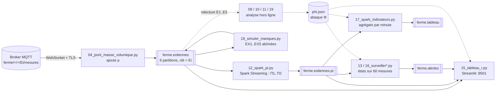

# Architecture et modèle de données

## Vue d'ensemble



Chaque flèche pleine est un flux continu ; les pointillés sont des lectures ponctuelles.
Tous les processus Python tournent dans le conteneur `app` (voir `docker-compose.yml`).

## Topics Kafka

| Topic | Partitions | Clé | Producteur | Contenu |
|---|---|---|---|---|
| `ferme.eoliennes` | 6 | nom de l'éolienne | pont 02 / 04, simulateur 18 | mesure brute JSON (+ `rho_kgm3` avec le pont 04) |
| `ferme.eoliennes.pi` | 6 | nom de l'éolienne | Spark 12 | `eolienne, zone, horodatage, seq, pi1, pi2` |
| `ferme.alertes` | 2 | nom de l'éolienne | surveillance 13 / 16 | un message par changement d'état |
| `ferme.tableau` | 1 | nom de l'éolienne | Spark 17 | indicateurs par éolienne et par minute |

Les quatre topics sont créés par le service `kafka-init` (l'auto-création est désactivée).

## Format des messages

Mesure (`ferme.eoliennes`) :

```json
{"eolienne": "E5", "zone": "champs", "horodatage": "2026-11-09T08:13:48.000+00:00", "seq": 42649,
 "diametre_m": 3.0, "vent_ms": 8.44, "temp_c": 11.76, "pression_hpa": 995.5,
 "rotation_rads": 35.998, "puissance_w": 1133.0, "rho_kgm3": 1.2061}
```

Alerte (`ferme.alertes`) :

```json
{"eolienne": "E8", "ancien_etat": null, "nouvel_etat": "OK", "mediane_r": 1.0102, "hors_abaque": 15,
 "r_sup_2": 0, "taille_fenetre": 60, "derniere_mesure": "2026-11-09T08:30:07.000+00:00",
 "emise_a": "2026-11-09T08:35:26.841575+00:00", "source": "16_surveiller"}
```

Indicateur par minute (`ferme.tableau`) :

```json
{"eolienne": "E12", "debut": "2026-11-09T08:30:00.000Z", "fin": "2026-11-09T08:31:00.000Z",
 "nb_mesures": 61, "mediane_r": 0.8512, "nb_suspects": 0, "nb_hors_abaque": 0, "etat": "SOUS_PRODUCTION"}
```

## Méthode

### Masse volumique (partie 04)

ρ = P / (R_air · T), avec P = `pression_hpa` × 100 (Pa), T = `temp_c` + 273,15 (K) et R_air = 287,05 J/(kg·K).
Une mesure sans pression ou sans température est transmise sans `rho_kgm3`.

### Groupes sans dimension (parties 05 à 07)

Cinq grandeurs (P, V, D, ω, ρ) et trois dimensions (M, L, T) : la matrice dimensionnelle est de rang 3,
donc 5 − 3 = 2 groupes indépendants (théorème de Vaschy-Buckingham) :

- Π1 = P / (ρ V³ D²) (coefficient de puissance, à un facteur π/8 près : C_p = (8/π)·Π1) ;
- Π2 = ω D / V (rapport de vitesse en bout de pale, à un facteur 2 près).

Le test `test_matrice_dimensionnelle_et_groupes_pi` vérifie le rang et le noyau avec sympy.

### Abaque Φ (partie 10)

Φ(Π2) = médiane de Π1 par tranche de Π2 de largeur 0,5, construite sur les éoliennes saines de référence E1 à E5.
Les points d'arrêt (Π1, Π2) = (0, 0) et les tranches de moins de 20 mesures sont écartés.
Résultat : 33 tranches, Π2 ∈ [6 ; 22,5[ (`results/tableaux/phi.json`).

### Écart à l'abaque et états (parties 11, 13, 16)

r = Π1 / Φ(Π2) pour chaque mesure. Sur les 60 dernières mesures d'une éolienne, par ordre de priorité :

| État | Règle |
|---|---|
| `HORS_ABAQUE` | plus de la moitié des Π2 hors des tranches de Φ (ou absents) |
| `CAPTEUR` (partie 16) | au moins une mesure avec r > 2 |
| `SOUS_PRODUCTION` | médiane de r < 0,9 |
| `SUR_PRODUCTION` | médiane de r > 1,1 |
| `OK` | sinon |

Toutes ces règles sont dans `scripts/commun.py` (`etat`, `ecart`, `construire_phi`) et partagées par la
surveillance, Spark 17 (réécrites en expressions Spark) et le tableau de bord.

### Données manquantes (partie 18)

`18_simuler_manques.py` republie E1..E5 sous les noms EX1..EX5 en les abîmant : EX1 perd 2 mesures sur 3,
EX2/EX3/EX4 perdent respectivement `puissance_w`, `vent_ms`, `rho_kgm3` dans 2 mesures sur 3, EX5 émet 2 min
puis se tait 3 min. Ces éoliennes sont toujours séparées des éoliennes réelles dans le tableau de bord.

## Organisation du code

| Fichier | Rôle |
|---|---|
| `scripts/commun.py` | configuration (.env), client MQTT, pont MQTT→Kafka, relecture d'un topic, physique, Φ, états |
| `scripts/NN_*.py` | un script par partie de l'énoncé (noms imposés) |
| `scripts/tdb/donnees.py` | consommateurs Kafka du tableau de bord (un fil par topic) et résumés par éolienne |
| `scripts/tdb/graphiques.py` | graphiques Altair |
| `scripts/tdb/composants.py` | HTML des cartes, tableaux, jauge, illustration SVG (valeurs échappées) |
| `scripts/tdb/theme.py` | palette, CSS, thème des graphiques |
| `tests/test_calculs.py` | tests hors réseau |
| `tests/test_mqtt_connection.py` | diagnostic de la connexion au broker |
