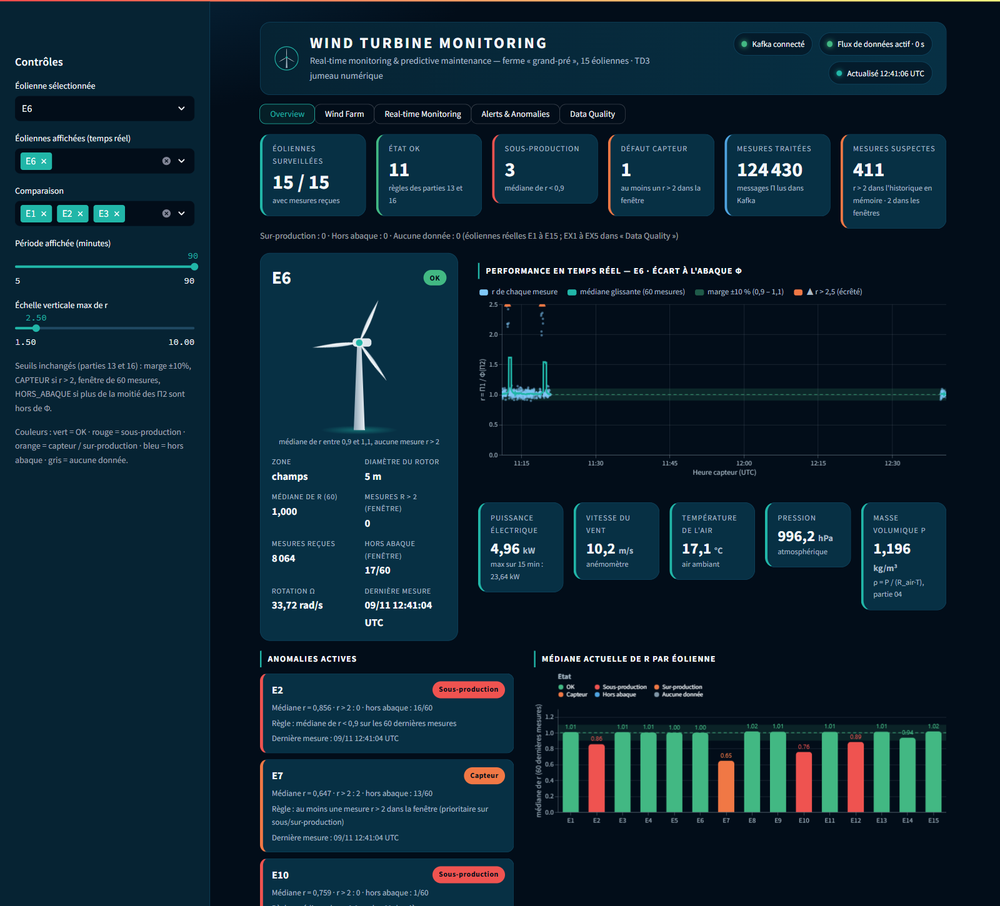
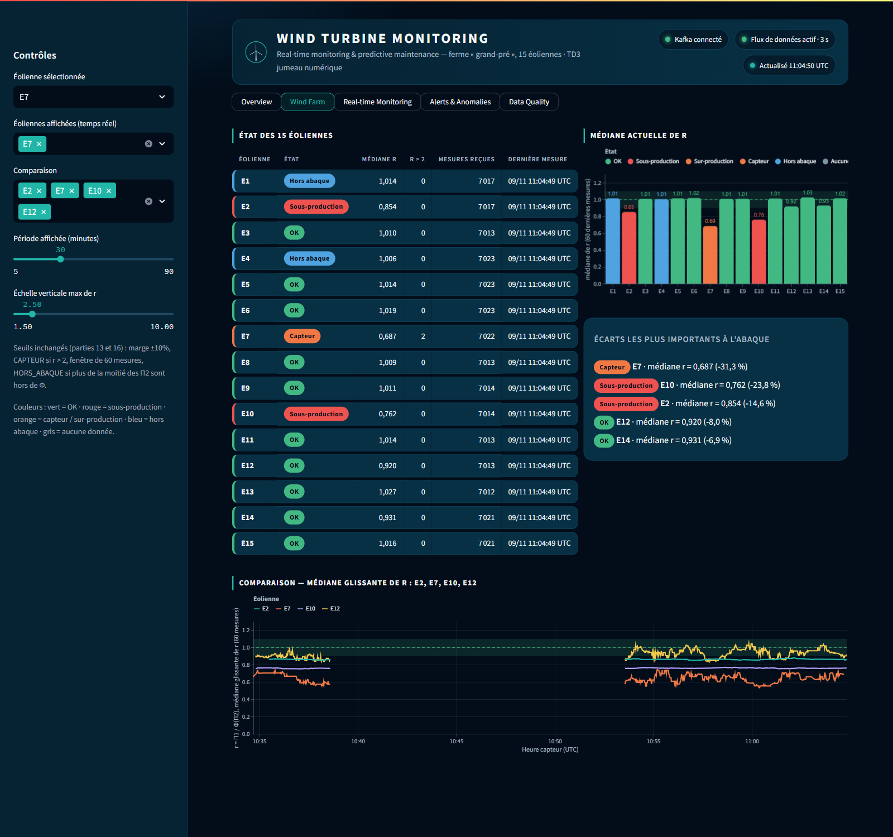
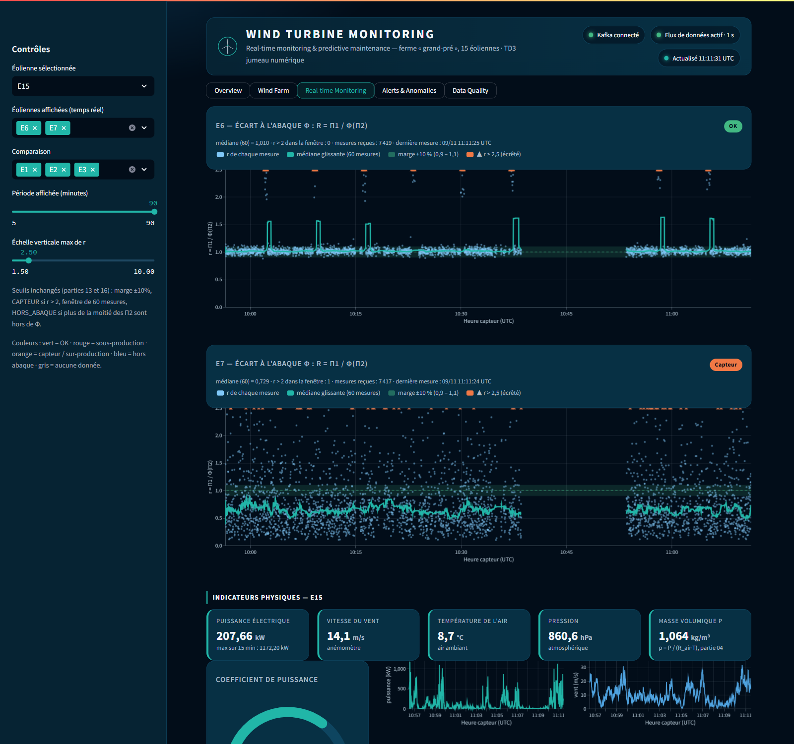
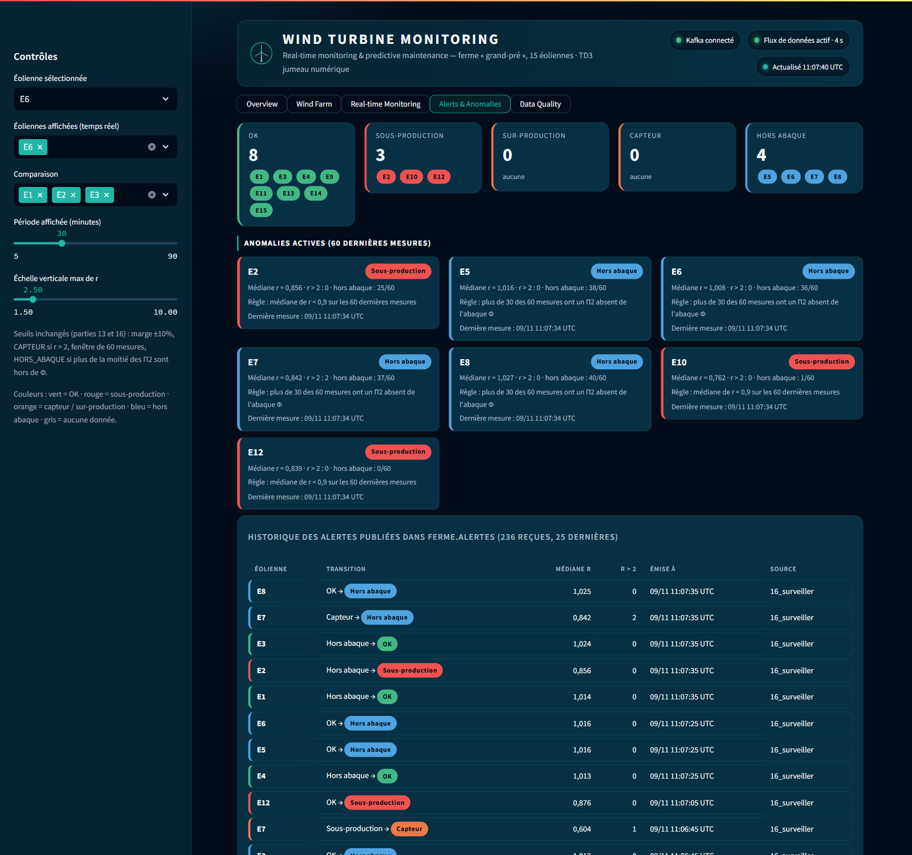

# Tableau de bord « Wind Turbine Monitoring »

Application Streamlit (`scripts/15_tableau_r.py`) qui lit Kafka en continu et se rafraîchit toutes les 5 s.
Aucune donnée n'est figée dans le code : tout vient de `ferme.eoliennes`, `ferme.eoliennes.pi` et `ferme.alertes`.

## Lancement

Depuis la racine du projet (pour que `.streamlit/config.toml` applique le thème sombre), dans le conteneur `app` :

```bash
streamlit run scripts/15_tableau_r.py --server.port 8501 --server.address 0.0.0.0
```

Puis <http://localhost:8501>. Prérequis : le pont 04 et le job Spark 12 tournent ; la surveillance 16 alimente
l'historique des alertes ; le simulateur 18 alimente EX1..EX5.

## Vues

| Vue | Contenu |
|---|---|
| **Overview** | production du parc (puissance instantanée, vent moyen, éoliennes en production, énergie produite sur ≈ 15 min), santé (éoliennes actives, OK, sous-production, défaut capteur, mesures r > 2), carte de l'éolienne sélectionnée (rotor animé selon ω réel), r(t), grandeurs physiques, anomalies actives, médiane de r par éolienne |
| **Wind Farm** | médiane actuelle de r, écarts les plus importants, tableau des 15 éoliennes, comparaison des médianes glissantes |
| **Real-time Monitoring** | graphique de la partie 15 (r par mesure, médiane glissante sur 60, marge ±10 %, valeurs écrêtées, zoom horizontal), grandeurs physiques sur 15 min, jauge C_p bornée par la limite de Betz |
| **Alerts & Anomalies** | répartition par état, cartes des anomalies avec la règle appliquée, historique de `ferme.alertes` |
| **Data Quality** | fraîcheur, complétude sur 5 min, champs absents, mesures perdues (sauts de `seq`) ; EX1..EX5 séparées et signalées comme simulées |

### Mode nuit / mode jour

Le sélecteur **Affichage** en haut de la barre latérale bascule entre un thème sombre (« Nuit », par défaut) et
un thème clair (« Jour »). Le choix est gardé dans l'URL (`?mode=jour`). Le HTML n'utilise que des variables
CSS (`tdb/theme.py`, `PALETTES`) ; les graphiques reçoivent la palette du mode (`theme.configurer`), et les widgets
Streamlit (thème de base sombre) sont recolorés en mode jour.

### Indicateurs de production

Calculés sur les mesures brutes de `ferme.eoliennes` (`donnees.production`) : puissance instantanée = somme des
dernières puissances des éoliennes actives (mesure de moins de 60 s), énergie = Σ P·Δt sur la fenêtre en mémoire
(Δt plafonné à 5 s pour ne pas compter un trou de données comme de la production).

### Codes couleur

Vert = OK, rouge = sous-production, orange = capteur / sur-production, bleu = hors abaque,
gris = aucune donnée. Une dernière mesure de plus de 60 s est signalée en orange (« il y a … ») : l'état affiché
est alors celui de la dernière mesure reçue, pas un état actuel.

## Paramètres d'URL

| Paramètre | Exemple | Effet |
|---|---|---|
| `vue` | `?vue=Wind Farm` | vue ouverte (mise à jour automatiquement quand on change d'onglet) |
| `mode` | `&mode=jour` | thème `nuit` (défaut) ou `jour` |
| `eolienne` | `&eolienne=E7` | éolienne sélectionnée |
| `eoliennes` | `&eoliennes=E6,E7` | éoliennes tracées dans « Real-time Monitoring » |
| `comparer` | `&comparer=E1,E2,E3` | éoliennes comparées dans « Wind Farm » |
| `minutes` | `&minutes=60` | période affichée, bornée à 5–90 (valeur invalide ignorée) |

## Fonctionnement

- `tdb/donnees.py` démarre un fil par topic (mis en cache par `st.cache_resource`, partagé entre onglets) :
  3600 dernières mesures Π par éolienne, 900 dernières mesures brutes, 300 dernières alertes.
- Un seul `st.fragment(run_every=5)` redessine en-tête, navigation et vue : deux fragments périodiques
  qui se chevauchaient faisaient disparaître la page pendant le rattrapage de l'historique.
- Les graphiques Altair sont envoyés avec `st.vega_lite_chart` et leurs données écrites dans la spec : avec
  `st.altair_chart`, chaque jeu de données porte le hash de son contenu et la mise à jour en place du navigateur
  échouait (« Error: Unrecognized data set »).
- Les états sont calculés par `commun.etat` (mêmes règles que les parties 13 et 16) ;
  `test_tableau_de_bord_fidele_aux_calculs` vérifie que le tableau de bord ne s'en écarte pas.

## Limites connues

- Premier affichage lent (quelques dizaines de secondes si Spark sature le CPU) : imports et relecture
  de `ferme.eoliennes.pi` depuis le début.
- Après modification d'un fichier, relancer Streamlit : le volume monté depuis Windows ne signale pas
  les changements au conteneur.
- La puissance nominale n'est pas publiée par les capteurs : la jauge porte sur C_p et la limite de Betz.

## Captures

| Overview | Wind Farm |
|---|---|
|  |  |
| **Real-time Monitoring** | **Alerts & Anomalies** |
|  |  |
