# Introduction

## Contexte

Une ferme de quinze éoliennes (E1 à E15), réparties sur quatre zones du site « grand-pré » (vallée, champs, colline, plateau), publie chaque seconde une mesure par éolienne sur un broker MQTT. Chaque mesure contient le diamètre du rotor, la vitesse du vent, la température et la pression de l'air, la vitesse de rotation du rotor et la puissance électrique produite.

Les éoliennes n'ont pas toutes la même taille (diamètres de 3 à 20 m) et ne voient pas le même vent : comparer directement leurs puissances n'a donc pas de sens. Le TD propose de construire, par analyse dimensionnelle, une représentation sans dimension du fonctionnement d'une éolienne, puis d'en déduire un **abaque de fonctionnement normal Φ** à partir de cinq éoliennes de référence (E1 à E5). Cet abaque sert ensuite de jumeau numérique : on compare en continu chaque éolienne à ce qu'elle « devrait » produire.

## Problématique et objectifs

La question centrale est la suivante : **comment détecter automatiquement, sur un flux continu de mesures, les éoliennes en panne, les défauts de capteur et les données manquantes, alors que les machines sont de tailles et d'environnements différents ?**

Les objectifs du TD, repris dans les dix-neuf parties de l'énoncé, sont :

- acheminer les mesures MQTT vers Kafka sans perte, puis les enrichir de la masse volumique de l'air (parties 01 à 04) ;
- établir par le théorème de Vaschy-Buckingham deux nombres sans dimension Π1 et Π2 (parties 05 à 07) ;
- construire et valider l'abaque Π1 = Φ(Π2) et identifier l'éolienne de référence en panne (parties 08 à 11) ;
- surveiller toute la ferme en continu avec Spark Structured Streaming, un système d'alertes et un tableau de bord (parties 12 à 17) ;
- étudier la robustesse de la chaîne face aux données manquantes et la fiabilité statistique de l'abaque (parties 18 et 19).

## Conventions du rapport

Toutes les valeurs numériques citées proviennent des mesures réelles reçues du broker du TD le 9 novembre 2026 (heure UTC des capteurs), sauf la partie 18, où les éoliennes EX1 à EX5 sont **simulées** à partir des mesures réelles, comme le demande l'énoncé. Les sorties brutes des scripts sont conservées dans `results/logs`. Les identifiants de connexion au broker ne figurent volontairement pas dans ce rapport.

# Architecture générale

## Vue d'ensemble

La chaîne réalisée est la suivante :

```
Broker MQTT (WebSocket + TLS, port 443)
  topics ferme/grand-pre/<zone>/<Ei>/mesures  -- 15 mesures/s
        |
        v   04_pont_masse_volumique.py  (paho-mqtt -> confluent-kafka, ajout de rho_kgm3)
Kafka  ferme.eoliennes      (6 partitions, clé = Ei, valeur = mesure JSON)
        |
        v   12_spark_pi.py  (Spark Structured Streaming)
Kafka  ferme.eoliennes.pi   (6 partitions, clé = Ei, valeur = {horodatage, seq, pi1, pi2})
        |                                   |
        |   13 / 16_surveiller*.py          |   17_spark_indicateurs.py (fenêtres d'1 min, watermark 2 min)
        v                                   v
Kafka  ferme.alertes  (changements d'état)   Kafka  ferme.tableau  (1 message / éolienne / minute)
        |
        +--> 15_tableau_r.py : tableau de bord Streamlit (r en direct, rafraîchi toutes les 5 s)

Scripts « batch » : 03, 08, 10, 11, 19 relisent ferme.eoliennes depuis le début -> figures et phi.json
```

L'ensemble tourne dans les conteneurs définis par le `docker-compose.yml` fourni : un broker Kafka 3.9.1 en mode KRaft (sans ZooKeeper), Kafka UI, et un conteneur `app` (Python 3.12, Java 21, PySpark 4.0.1 avec le connecteur Kafka préinstallé) dans lequel s'exécutent tous les scripts.

## Rôle de chaque brique

- **MQTT** est le protocole de publication des capteurs : léger, orienté *publish/subscribe*, adapté à des objets connectés. Il ne conserve pas l'historique : un message non lu au moment de sa publication est perdu pour l'abonné.
- **Kafka** joue le rôle de journal durable et rejouable. Le pont recopie chaque mesure dans `ferme.eoliennes` ; tous les traitements en aval peuvent alors relire les mesures depuis le début, à leur rythme, et indépendamment les uns des autres. La clé de message (nom de l'éolienne) garantit que toutes les mesures d'une éolienne vont dans la même partition, donc dans l'ordre.
- **Python** assure l'ingestion (pont MQTT → Kafka), les analyses ponctuelles (graphiques, construction de Φ), la surveillance par fenêtre glissante et le tableau de bord.
- **Spark Structured Streaming** réalise les calculs continus et parallélisables : calcul des groupes Π pour chaque mesure (partie 12) et agrégation par minute selon l'heure des capteurs, avec gestion des retards (partie 17).
- **L'analyse dimensionnelle** fournit le modèle : elle réduit cinq grandeurs physiques à deux nombres sans dimension, ce qui permet de comparer sur une même courbe des éoliennes de tailles différentes soumises à des vents et à des densités d'air différents.

## Organisation du code

Les scripts portent les noms imposés par l'énoncé (`scripts/01_mqtt.py` … `scripts/19_convergence.py`). Le code partagé est regroupé dans `scripts/commun.py` : lecture du fichier `.env`, création du client MQTT (WebSocket, TLS, chemin `/mqtt`), pont MQTT → Kafka, relecture complète d'un topic, calcul de ρ, de Π1 et Π2, construction de Φ et règles d'état. Ce regroupement garantit que les parties 10, 11, 13, 15, 16 et 19 utilisent exactement les mêmes définitions. Les tests hors réseau (`tests/test_calculs.py`) vérifient ces fonctions, et `tests/test_mqtt_connection.py` vérifie la connexion réelle au broker.

# Acquisition des mesures (parties 01 à 04)

## Partie 01 — Écouter le broker

### Objectif

Se connecter au broker avec les identifiants du `.env`, écouter tous les topics pendant quelques secondes, enregistrer chaque topic rencontré une seule fois avec un exemple de message (`topics.jsonl`), ainsi que toutes les mesures d'éoliennes (`mesures.jsonl`).

### Méthode et implémentation

Le broker n'est accessible qu'en **MQTT sur WebSocket sécurisé** (port 443, TLS, chemin `/mqtt`). La fonction `creer_client_mqtt()` de `commun.py` construit un client `paho-mqtt` 2.1 : `transport="websockets"`, `tls_set()` avec le magasin de certificats `certifi`, `ws_set_options(path="/mqtt")`, identifiants lus dans le `.env`, et un identifiant de session unique pour que deux scripts lancés en même temps ne s'éjectent pas mutuellement. Le script `01_mqtt.py` s'abonne au filtre `#` (tous les topics), mémorise dans un dictionnaire le premier message reçu pour chaque topic, et décode en JSON les messages des topics se terminant par `/mesures`. Un message non JSON est ignoré sans interrompre l'écoute.

Avant ce script, un diagnostic pas à pas (`tests/test_mqtt_connection.py`) a été exécuté. Il n'affiche jamais le mot de passe.

| Étape vérifiée | Résultat réel |
|---|---|
| Résolution DNS | `master2026.lemansschoolofai.fr` → 137.74.173.64 |
| Port TCP 443 | ouvert |
| TLS | TLS 1.3, certificat valide pour le nom du broker |
| WebSocket `/mqtt` et authentification | CONNACK « Success » |
| Abonnement `#` | accordé (QoS 0) |
| Réception | 150 messages en 10 s sur 15 topics |

### Résultats

Une écoute de 30 s a produit **15 topics** et **450 mesures** (30 par éolienne, soit exactement une mesure par seconde et par éolienne). Les topics suivent le schéma `ferme/grand-pre/<zone>/<éolienne>/mesures` ; aucun autre topic n'a été reçu avec l'abonnement `#`.

| Zone | Éoliennes (diamètre) |
|---|---|
| vallee | E1 (3 m), E2 (5 m), E3 (5 m), E4 (8 m) |
| champs | E5 (3 m), E6 (5 m), E7 (8 m), E8 (12 m) |
| colline | E9 (5 m), E10 (8 m), E11 (8 m), E12 (12 m) |
| plateau | E13 (8 m), E14 (12 m), E15 (20 m) |

Chaque message est un objet JSON plat, par exemple (topic `ferme/grand-pre/vallee/E1/mesures`) :

```
{"eolienne": "E1", "zone": "vallee", "horodatage": "2026-11-09T08:13:48.000+00:00", "seq": 42649,
 "diametre_m": 3.0, "vent_ms": 2.72, "vent_kmh": 9.792, "temp_c": 13.98, "pression_hpa": 994.27,
 "rotation_rads": 0.0, "puissance_w": 0.0, "puissance_kw": 0.0}
```

L'horodatage est celui du capteur (ISO 8601, UTC, à la seconde) ; `seq` est un compteur partagé par les quinze éoliennes, incrémenté à chaque seconde. Les unités sont données dans le nom des champs.

### Commentaire

Le flux est régulier (1 Hz) et parfaitement structuré, ce qui simplifie la suite. Le compteur `seq` et l'horodatage permettront plus loin de trier les mesures et de repérer les trous dans les données.

## Partie 02 — Recopier les mesures dans Kafka

### Objectif

Écrire un pont continu qui s'abonne uniquement aux mesures et les recopie dans `ferme.eoliennes`, avec le nom de l'éolienne comme clé et le message JSON intact comme valeur, sans perdre de mesure à l'arrêt.

### Méthode et implémentation

La fonction `pont()` de `commun.py` (appelée par `02_pont_kafka.py`) :

- s'abonne au filtre `ferme/+/+/+/mesures` (QoS 1), qui ne capte que les mesures ;
- extrait la clé du topic (avant-dernier segment, `E1` … `E15`), ce qui reste valable même si le contenu du message était illisible ;
- envoie les **octets reçus, sans décodage ni réencodage** (`value=msg.payload`) : le message est strictement intact ;
- utilise un producteur `confluent-kafka` configuré avec `acks=all` et `enable.idempotence=true` : un message n'est considéré comme écrit qu'après accusé de réception du broker, et un renvoi automatique ne crée pas de doublon ;
- gère la saturation de la file locale du producteur (`BufferError` : on laisse partir des messages puis on réessaie) ;
- sur Ctrl+C (ou SIGTERM), arrête d'abord la boucle MQTT (plus aucun message accepté), se déconnecte, puis appelle `producer.flush(30)`, qui bloque jusqu'à l'accusé de tous les messages encore en file.

La reconnexion MQTT est automatique (`reconnect_delay_set(1, 30)`) ; elle s'est d'ailleurs produite en conditions réelles pendant le TD (coupure réseau lors d'une mise en veille du poste) sans arrêt du pont.

### Résultats

Le pont a tourné environ 3 minutes, puis a été arrêté par un signal SIGINT (équivalent de Ctrl+C). Sa sortie indique `Arrêt : 2702 mesures transmises, 0 non accusées`. Les offsets de `ferme.eoliennes` sont passés de 420 à 3122 messages, soit **exactement 2702 messages ajoutés** : aucune mesure reçue n'a été perdue à l'arrêt. La répartition par clé sur les 6 partitions est conforme : 15 clés, donc certaines partitions reçoivent plusieurs éoliennes.

### Commentaire

La garantie porte sur les mesures **reçues** par le pont. Pendant que le pont est arrêté, les mesures publiées sur MQTT ne sont pas conservées par le broker pour nous (session non persistante) : pour couvrir aussi cette fenêtre, il faudrait une session persistante (`clean_start=False` et identifiant client fixe) que le broker accepterait de stocker. C'est précisément ce rôle de mémoire que Kafka joue pour les traitements en aval.

## Partie 03 — Relire Kafka et tracer

### Objectif

Relire depuis le début toutes les mesures de `ferme.eoliennes`, garder E1 et E2 et tracer la puissance en fonction du vent.

### Méthode et implémentation

`lire_topic()` (dans `commun.py`) crée un consommateur à identifiant de groupe unique, lit les *high watermarks* de chaque partition, se positionne au début (`OFFSET_BEGINNING`) et lit jusqu'à atteindre la fin actuelle de chaque partition. On obtient ainsi une relecture complète et reproductible, sans dépendre d'un délai d'attente arbitraire. `03_consumer.py` filtre les clés E1 et E2 et trace P en fonction de V.

### Résultats

La figure a d'abord été produite sur les mesures du pont 02 (209 mesures par éolienne), puis régénérée en fin de TD sur l'ensemble du topic (2550 mesures par éolienne, de 08:13 à 09:36 UTC). C'est cette dernière version qui est présentée.

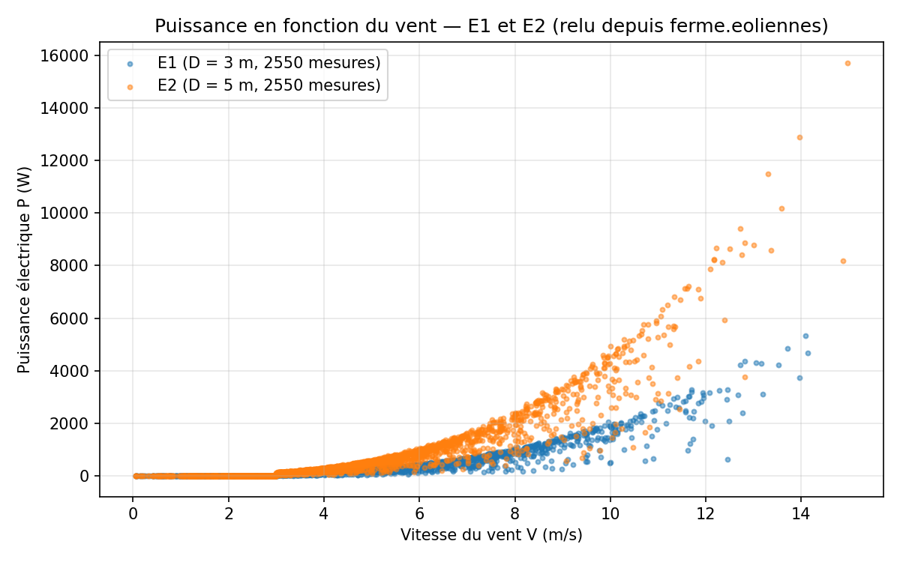

Rapports des puissances médianes à vent égal (fenêtres de ±0,25 m/s) :

| Vent V | P médiane E1 | P médiane E2 | P(E2) / P(E1) |
|---|---|---|---|
| 6 m/s | 361 W | 874 W | 2,42 |
| 8 m/s | 888 W | 1917 W | 2,16 |
| 10 m/s | 1643 W | 3896 W | 2,37 |

### Pourquoi les deux courbes ne se superposent-elles pas ?

La puissance d'une éolienne vaut P = C_p · ½ ρ · (πD²/4) · V³ : à vent égal, elle est **proportionnelle à la surface balayée, donc à D²**. E2 a un diamètre de 5 m contre 3 m pour E1 : sa surface est (5/3)² ≈ 2,78 fois plus grande, d'où une courbe nettement au-dessus. Le rapport mesuré (2,2 à 2,4) est cependant inférieur à 2,78 : E2 produit moins que ce que sa taille laisserait prévoir, ce qui annonce le défaut identifié en partie 11. Deux autres facteurs dispersent les points : la densité de l'air ρ (identique pour E1 et E2, situées dans la même vallée, mais pas d'une zone à l'autre) et le régime de rotation (à un même vent, le rotor ne tourne pas toujours à la même vitesse, donc C_p varie). La courbe P(V) brute est donc propre à chaque machine : elle ne permet pas de comparer des éoliennes entre elles, d'où l'intérêt de l'analyse dimensionnelle.

On lit aussi sur la figure le seuil de démarrage : en dessous de 3 m/s, la puissance est nulle (rotor arrêté).

## Partie 04 — Enrichir les mesures

### Objectif

Ajouter à chaque mesure, dans le pont, la masse volumique de l'air `rho_kgm3` = P / (R_air · T), avec R_air = 287,05 J·kg⁻¹·K⁻¹, P en Pa et T en K.

### Méthode et implémentation

`04_pont_masse_volumique.py` réutilise la fonction `pont()` en lui passant une transformation `ajouter_rho` : décodage JSON, conversion d'unités, ajout du champ, réencodage. Les conversions sont `p [Pa] = pression_hpa × 100` et `T [K] = temp_c + 273,15` :

$$ρ = (pression_hpa × 100) / (287,05 × (temp_c + 273,15))   [kg·m⁻³]$$

Homogénéité : Pa / (J·kg⁻¹·K⁻¹ · K) = (kg·m⁻¹·s⁻²) / (m²·s⁻²·kg⁻¹) = kg·m⁻³. Le test unitaire vérifie la valeur de l'atmosphère standard (1013,25 hPa, 15 °C) : ρ = 1,225 kg·m⁻³. Si la pression ou la température manque, la mesure est transmise sans `rho_kgm3` plutôt que perdue ; un message non JSON est compté comme invalide et ignoré (aucun cas observé : `0 invalides`).

### Résultats

Le pont enrichi a tourné en continu de 08:29 UTC à la fin de la session, puis a été arrêté par SIGINT sans perte (91 904 mesures transmises, 0 non accusée). Exemple de mesure enrichie relue dans Kafka : `{"eolienne": "E1", …, "temp_c": 12.47, "pression_hpa": 998.18, …, "rho_kgm3": 1.217482}`. Les plages observées sont cohérentes avec l'altitude des zones :

| Zone | ρ minimale | ρ maximale |
|---|---|---|
| vallée (E1-E4) | 1,193 | 1,233 |
| champs (E5-E8) | 1,184 | 1,232 |
| colline (E9-E12) | 1,136 | 1,181 |
| plateau (E13-E15) | 1,050 | 1,091 |

L'air du plateau est environ 12 % moins dense que celui de la vallée : à vent et diamètre égaux, une éolienne du plateau dispose de 12 % de puissance en moins.

> **Purge du topic.** L'énoncé demande de vider les partitions de `ferme.eoliennes` avant de relancer le pont. Pendant la session, le pont enrichi a été relancé sans attendre cette purge, qui a été faite après coup. Les 3122 mesures non enrichies de la partie 02 occupaient exactement le début de chaque partition (offsets 0 à 623, 207, 207, 1041, 415 et 623 pour les partitions 0 à 5, aucune mesure brute au-delà). Elles ont été supprimées avec `kafka-delete-records.sh`, l'opération qu'exécute le bouton « Purge messages » de Kafka UI, mais limitée à ces offsets pour conserver les mesures enrichies. Après la purge, `ferme.eoliennes` ne contient plus aucune mesure réelle sans `rho_kgm3` (`results/logs/04_purge_mesures_brutes.log`). Les résultats du rapport n'en dépendent pas : toutes les fonctions de calcul des Π écartaient déjà les mesures sans ρ, et dans le flux Spark elles donnaient un Π1 nul, donc aucun r.

# Analyse dimensionnelle (parties 05 à 07)

## Partie 05 — Analyse dimensionnelle

### Objectif

Recenser les grandeurs physiques présentes dans chaque mesure, donner leur dimension dans le système SI, puis construire la matrice dimensionnelle des variables utiles (sans la température ni la pression, déjà contenues dans ρ) et en calculer le rang.

### Variables physiques d'une mesure et dimensions SI

On note M la masse (kg), L la longueur (m), T le temps (s) et Θ la température (K). Les champs `eolienne`, `zone`, `horodatage` et `seq` sont des identifiants ou des repères temporels : ils ne sont pas des grandeurs physiques du problème.

| Champ du message | Grandeur | Symbole | Unité SI | Dimension |
|---|---|---|---|---|
| `diametre_m` | diamètre du rotor | D | m | L |
| `vent_ms` (et `vent_kmh`) | vitesse du vent | V | m·s⁻¹ | L·T⁻¹ |
| `temp_c` | température de l'air | T_air | K (après + 273,15) | Θ |
| `pression_hpa` | pression atmosphérique | p | Pa = kg·m⁻¹·s⁻² (après × 100) | M·L⁻¹·T⁻² |
| `rotation_rads` | vitesse angulaire du rotor | ω | rad·s⁻¹ | T⁻¹ (le radian est sans dimension) |
| `puissance_w` (et `puissance_kw`) | puissance électrique | P | W = kg·m²·s⁻³ | M·L²·T⁻³ |
| `rho_kgm3` (ajouté en partie 04) | masse volumique de l'air | ρ | kg·m⁻³ | M·L⁻³ |

`vent_kmh` et `puissance_kw` sont la même grandeur que `vent_ms` et `puissance_w` dans une autre unité : on ne les compte qu'une fois. La dimension de la puissance se retrouve par W = J·s⁻¹ = N·m·s⁻¹ = kg·m·s⁻²·m·s⁻¹ = kg·m²·s⁻³.

### Matrice dimensionnelle

Sans T_air ni p, il reste n = 5 variables : P, V, D, ω, ρ. Chaque colonne contient les exposants de M, L et T de la variable :

| Unité de base | P | V | D | ω | ρ |
|---|---|---|---|---|---|
| M (kg) | 1 | 0 | 0 | 0 | 1 |
| L (m) | 2 | 1 | 1 | 0 | −3 |
| T (s) | −3 | −1 | 0 | −1 | 0 |

Les autres unités SI de base (K, A, mol, cd) n'interviennent dans aucune de ces cinq variables : leurs lignes seraient entièrement nulles et ne changeraient pas le rang ; on ne les écrit donc pas.

### Rang de la matrice

La matrice A est de taille 3 × 5, donc rg(A) ≤ 3. Pour montrer que rg(A) = 3, il suffit de trouver un mineur d'ordre 3 non nul. On prend les colonnes V, D, ρ :

$$Δ = det [ (0, 0, 1) ; (1, 1, −3) ; (−1, 0, 0) ]   (lignes M, L, T ; colonnes V, D, ρ)$$

En développant selon la première ligne, seul le troisième terme est non nul :

$$det = (+1) × 1 × det [ 1 1 ; −1 0 ] = 1 × (1 × 0 − 1 × (−1)) = 1 ≠ 0$$

Le mineur est non nul, donc **rg(A) = 3**. Ce résultat a été vérifié numériquement avec `sympy` dans `tests/test_calculs.py` (`Matrix.rank() == 3`).

Physiquement, le rang 3 signifie que les trois dimensions M, L et T sont réellement indépendantes dans le problème : V, D et ρ suffisent à les « porter » toutes les trois (ρ apporte la masse, D la longueur, V le temps).

## Partie 06 — Groupes Π

### Objectif

Appliquer le théorème de Vaschy-Buckingham pour obtenir deux nombres sans dimension indépendants.

### Nombre de groupes

Avec n = 5 variables et une matrice de rang r = 3, le théorème garantit l'existence de **n − r = 5 − 3 = 2** groupes sans dimension indépendants, et toute relation physique f(P, V, D, ω, ρ) = 0 peut se réécrire F(Π1, Π2) = 0, soit Π1 = Φ(Π2).

### Choix des variables répétées

On choisit comme variables de base ρ, V et D : ce sont exactement les trois colonnes du mineur non nul de la partie 05, elles sont donc dimensionnellement indépendantes et engendrent M, L et T. Les deux variables restantes, P et ω, donnent chacune un groupe.

### Calcul de Π1 (à partir de la puissance P)

On cherche a, b, c tels que Π1 = P · ρᵃ · Vᵇ · Dᶜ soit sans dimension :

$$[Π1] = (M·L²·T⁻³) · (M·L⁻³)ᵃ · (L·T⁻¹)ᵇ · Lᶜ = M⁽¹⁺ᵃ⁾ · L⁽²⁻³ᵃ⁺ᵇ⁺ᶜ⁾ · T⁽⁻³⁻ᵇ⁾$$

On annule chaque exposant :

- M : 1 + a = 0, donc a = −1 ;
- T : −3 − b = 0, donc b = −3 ;
- L : 2 − 3a + b + c = 0, soit 2 + 3 − 3 + c = 0, donc c = −2.

$$Π1 = P / (ρ · V³ · D²)$$

Vérification d'homogénéité : kg·m²·s⁻³ / (kg·m⁻³ · m³·s⁻³ · m²) = kg·m²·s⁻³ / (kg·m²·s⁻³) = 1.

### Calcul de Π2 (à partir de la vitesse de rotation ω)

On cherche Π2 = ω · ρᵃ · Vᵇ · Dᶜ :

$$[Π2] = T⁻¹ · (M·L⁻³)ᵃ · (L·T⁻¹)ᵇ · Lᶜ = Mᵃ · L⁽⁻³ᵃ⁺ᵇ⁺ᶜ⁾ · T⁽⁻¹⁻ᵇ⁾$$

- M : a = 0 ;
- T : −1 − b = 0, donc b = −1 ;
- L : −3a + b + c = 0, soit −1 + c = 0, donc c = 1.

$$Π2 = ω · D / V$$

Vérification : s⁻¹ · m / (m·s⁻¹) = 1. Les vecteurs d'exposants (1, −3, −2, 0, −1) et (0, −1, 1, 1, 0) dans l'ordre (P, V, D, ω, ρ) sont bien dans le noyau de A et sont indépendants (vérifié avec `sympy`).

### Interprétation physique

- **Π1** compare la puissance produite au flux d'énergie cinétique du vent qui traverse le rotor. Le coefficient de puissance usuel est C_p = P / (½ ρ A V³) avec A = πD²/4, d'où **C_p = (8/π) · Π1 ≈ 2,55 · Π1**. La limite de Betz (C_p ≤ 16/27 ≈ 0,593) impose donc **Π1 ≤ 2π/27 ≈ 0,233** pour toute éolienne réelle.
- **Π2** compare la vitesse du bout des pales (ω·D/2) à celle du vent : c'est le double du *tip speed ratio* λ = ωR/V, soit **λ = Π2 / 2**.

Ces deux groupes sont donc les variables classiques de l'aérodynamique des éoliennes, et la relation Π1 = Φ(Π2) est, à un facteur près, la courbe C_p(λ) d'un rotor.

## Partie 07 — Rôle de ρ

L'introduction de ρ a été utile pour trois raisons.

1. **Sans ρ, la température ne pouvait entrer dans aucun groupe Π.** Avec les variables P, V, D, ω, p et T_air, la température est la seule à porter la dimension Θ : aucun produit de puissances de ces variables ne peut la rendre sans dimension. L'analyse aurait conclu, à tort, que le fonctionnement ne dépend pas de la température. C'est la constante R_air = 287,05 J·kg⁻¹·K⁻¹ (qui contient Θ) qui permet de combiner p et T_air en une grandeur mécanique ρ = p / (R_air · T_air), de dimension M·L⁻³. On injecte ainsi une loi physique connue (gaz parfait) dans le modèle.
2. **ρ est la grandeur qui intervient réellement dans la physique du problème.** La puissance disponible dans le vent vaut ½ ρ A V³ : c'est la masse d'air traversant le rotor qui compte, pas séparément sa pression et sa température.
3. **ρ réduit le nombre de variables.** Avec (P, V, D, ω, p, T_air), on aurait n = 6 et un rang 4 (M, L, T, Θ), donc encore 2 groupes, par exemple P/(p·V·D²) et ω·D/V : T_air en serait exclue, et le premier groupe ne mesurerait pas correctement l'énergie disponible, puisque p seule ne fixe pas la masse d'air. En remplaçant deux variables et une dimension par la seule variable ρ, on obtient 2 groupes qui contiennent toute l'information utile. Un abaque à une seule variable d'entrée (Π2) se construit et se lit beaucoup plus facilement. Enfin, ρ permet de comparer des éoliennes placées à des altitudes et des températures différentes (vallée, colline, plateau) : sa variation de quelques pour cent modifie directement la puissance disponible.

# Construction de l'abaque Φ (parties 08 à 11)

## Partie 08 — La forme de Φ

### Objectif

Le théorème de Vaschy-Buckingham garantit l'existence d'une relation Π1 = Φ(Π2) mais n'en donne pas la forme. On la cherche expérimentalement en traçant le nuage Π1(Π2) des éoliennes E1 à E5.

### Méthode et implémentation

`08_phi_tracer.py` relit `ferme.eoliennes` (fonction `lire_topic`) en ne gardant que les clés E1 à E5, calcule pour chaque mesure, avec la fonction `groupes_pi` :

$$Π1 = puissance_w / (rho_kgm3 · vent_ms³ · diametre_m²)$$

$$Π2 = rotation_rads · diametre_m / vent_ms$$

et trace les cinq nuages sur un même graphique. Une mesure à laquelle il manque un champ (en particulier les mesures de la partie 02, sans `rho_kgm3`), ou dont le vent est nul, est écartée : on ne divise jamais par zéro. La fonction `points_par_eolienne` est réutilisée telle quelle par les parties 10, 11 et 19.

### Résultat

Le script a été exécuté à 09:02 UTC sur environ 33 minutes de mesures enrichies : 2004 mesures par éolienne.

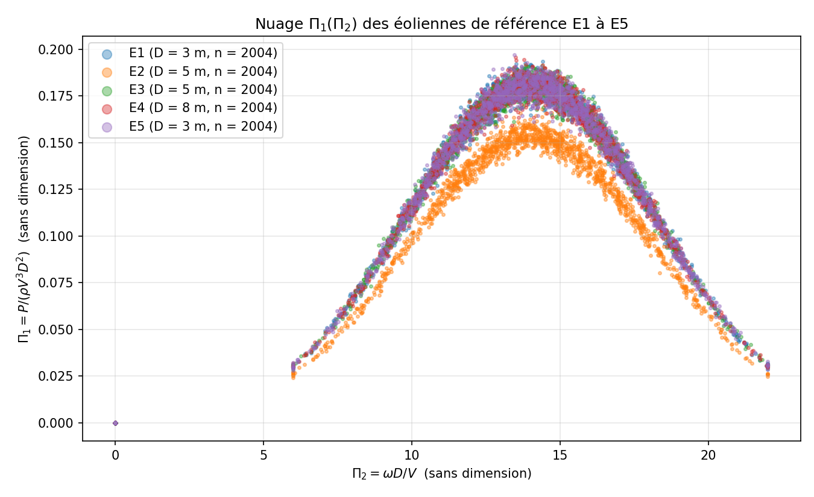

## Partie 09 — Lecture du graphique

Le graphique de la partie 08 montre d'abord que **les cinq éoliennes, de diamètres différents (3, 5, 5, 8 et 3 m), situées dans deux zones et soumises à des vents de 0 à 18 m/s, se rangent sur une seule et même courbe**. En variables dimensionnelles (partie 03), leurs courbes P(V) étaient séparées d'un facteur supérieur à 2 ; en variables sans dimension, elles se confondent. C'est exactement ce que prédit le théorème de Vaschy-Buckingham : si les éoliennes sont géométriquement semblables, Π1 ne dépend que de Π2, quelles que soient la taille de la machine, la densité de l'air et la vitesse du vent. La forme de Φ apparaît alors directement :

- une **courbe en cloche** : Π1 croît avec Π2, atteint un maximum d'environ 0,18 pour Π2 ≈ 14, puis décroît. C'est l'allure classique de la courbe C_p(λ) d'un rotor : si les pales tournent trop lentement par rapport au vent, l'air passe sans être freiné ; si elles tournent trop vite, le rotor se comporte comme un disque plein que l'air contourne ;
- un maximum cohérent avec la physique : Π1 ≈ 0,179 correspond à C_p = (8/π) · 0,179 ≈ 0,455, en dessous de la limite de Betz (0,593), pour un *tip speed ratio* λ = Π2/2 ≈ 7, valeur typique d'une éolienne tripale ;
- un **domaine limité** : en fonctionnement, Π2 reste compris entre 6 et 22 (λ entre 3 et 11), ce qui traduit la régulation de la vitesse de rotation ;
- un amas de points en **(0, 0)** : rotor arrêté (voir partie 10).

Le graphique fait enfin apparaître, d'un seul coup d'œil, une **bande de points nettement en dessous de la courbe commune, appartenant à E2** : à Π2 donné, E2 extrait moins de puissance du vent que ses voisines. L'analyse dimensionnelle transforme ainsi une comparaison impossible (machines différentes, vents différents) en une comparaison directe à une référence commune.

## Partie 10 — Construire l'abaque Φ

### Objectif

Construire une table Φ donnant, pour chaque tranche de Π2 de largeur 0,5, la médiane de Π1 des mesures de E1 à E5 (tranches de moins de 20 mesures écartées), l'enregistrer dans `phi.json`, et la tracer avec une marge de ±10 % et la moyenne de Π1 par tranche.

### Méthode et implémentation

1. Les points d'arrêt (Π1 = 0 et Π2 = 0) sont retirés (fonction `est_arret`).
2. Chaque mesure est affectée à la tranche k = ⌊Π2 / 0,5⌋, qui couvre l'intervalle [0,5k ; 0,5(k+1)[.
3. Pour chaque tranche contenant au moins 20 mesures, Φ(k) = médiane des Π1 (`construire_phi`).
4. `phi.json` contient, pour chaque tranche retenue, son indice, ses bornes, son effectif et la valeur de Φ ; `phi_detail.csv` contient en plus la moyenne et les tranches écartées.

Φ est volontairement une **table en escalier** (valeur constante par tranche), comme le demande l'énoncé ; aucune interpolation n'est ajoutée. Une mesure dont Π2 tombe dans une tranche absente de la table est dite « hors abaque ».

### Résultats

Exécution à 09:02 UTC : 10 055 mesures de E1 à E5, dont **2648 points d'arrêt (26 %) écartés**, soit 7407 mesures utiles réparties sur 34 tranches. **33 tranches sont retenues**, de Π2 = 6,0 à 22,5 ; seule la tranche [5,5 ; 6,0[ (5 mesures) est écartée. Extrait de la table :

| Tranche de Π2 | Mesures | Φ = médiane de Π1 | Moyenne de Π1 | Écart moyenne / médiane |
|---|---|---|---|---|
| [6,0 ; 6,5[ | 51 | 0,0304 | 0,0307 | +1,0 % |
| [8,0 ; 8,5[ | 98 | 0,0714 | 0,0703 | −1,5 % |
| [10,0 ; 10,5[ | 207 | 0,1210 | 0,1197 | −1,1 % |
| [12,0 ; 12,5[ | 364 | 0,1644 | 0,1609 | −2,1 % |
| [14,0 ; 14,5[ | 485 | 0,1786 | 0,1753 | −1,8 % |
| [16,0 ; 16,5[ | 358 | 0,1554 | 0,1522 | −2,1 % |
| [18,0 ; 18,5[ | 179 | 0,1074 | 0,1065 | −0,8 % |
| [20,0 ; 20,5[ | 54 | 0,0600 | 0,0593 | −1,2 % |
| [22,0 ; 22,5[ | 20 | 0,0307 | 0,0296 | −3,6 % |

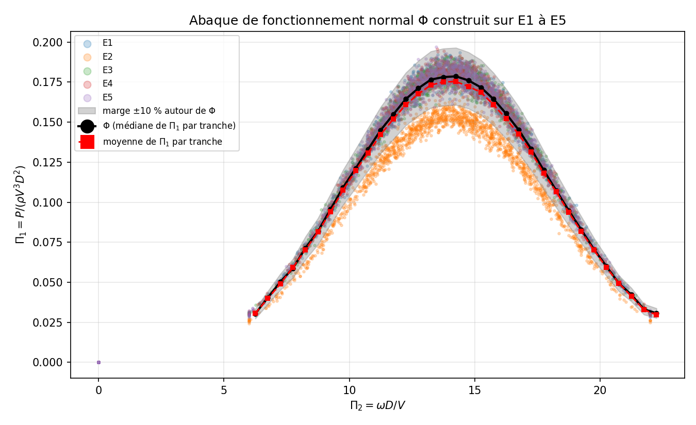

### Pourquoi la médiane plutôt que la moyenne ?

Dans chaque tranche, environ un cinquième des points provient d'une éolienne en panne. La moyenne donne le même poids à chaque point : les points de l'éolienne défaillante tirent toute la courbe vers le bas. On le mesure directement : **la moyenne est inférieure à la médiane dans presque toutes les tranches, de 1 à 2 % autour du maximum** (courbe rouge sous la courbe noire sur la figure). La médiane, elle, ne dépend que du rang des valeurs : tant que moins de la moitié des points d'une tranche sont aberrants, elle reste dans la population des éoliennes saines. Son point de rupture est de 50 % contre 0 % pour la moyenne : un seul point extrême, par exemple une mesure de capteur à Π1 = 0,7, suffit à déplacer la moyenne, pas la médiane. Pour construire une référence de **fonctionnement normal** à partir d'un échantillon qui contient des machines anormales, la médiane est donc l'estimateur adapté.

### Que représentent les points en (0, 0) et pourquoi les écarter ?

Un point (0, 0) correspond à une mesure où le rotor est immobile (ω = 0, donc Π2 = 0) et la puissance nulle (P = 0, donc Π1 = 0). Les données montrent que ces arrêts sont **tous** dus au vent : sur l'ensemble des mesures enrichies, le rotor ne tourne jamais en dessous de 3 m/s (vitesse de démarrage) ni au-dessus de 25 m/s (mise en sécurité par vent fort), et il tourne toujours entre ces deux bornes. Ces points décrivent donc une décision de la régulation (« ne pas produire »), pas le comportement aérodynamique du rotor que Φ doit représenter. Il faut les écarter car :

- ils ne sont pas sur la courbe Φ(Π2) : les inclure créerait une tranche [0 ; 0,5[ de valeur Φ = 0, qui n'a pas de sens physique ;
- avec Φ = 0, l'écart r = Π1/Φ deviendrait 0/0 pour toute éolienne à l'arrêt ;
- ils sont très nombreux (26 % des mesures de E1 à E5) : en les gardant, une éolienne bloquée à l'arrêt par vent favorable serait jugée « normale ».

## Partie 11 — Trouver la panne

### Objectif

Calculer pour chaque mesure de E1 à E5 l'écart à l'abaque r = Π1 / Φ(Π2), puis, par éolienne, la médiane de r et la part des mesures hors de la marge de ±10 %.

### Méthode et implémentation

La fonction `ecart` cherche la tranche de Π2 dans la table et renvoie r = Π1 / Φ, ou rien si la tranche est absente (hors abaque) ou si Π1 ou Π2 manque. Les points d'arrêt sont exclus comme en partie 10. Une mesure est hors marge si |r − 1| > 0,10.

### Résultats

| Éolienne | Mesures | Arrêts (0,0) | r calculés | Médiane de r | Hors marge ±10 % |
|---|---|---|---|---|---|
| E1 | 2017 | 590 | 1427 | 1,011 | 2,5 % |
| **E2** | 2017 | 595 | 1421 | **0,857** | **90,1 %** |
| E3 | 2017 | 600 | 1415 | 1,011 | 1,2 % |
| E4 | 2017 | 596 | 1419 | 1,010 | 1,6 % |
| E5 | 2017 | 282 | 1735 | 1,011 | 2,0 % |

(Le script, lancé quelques secondes après la partie 10, a lu 13 mesures de plus par éolienne ; Φ est celui de `phi.json`.)

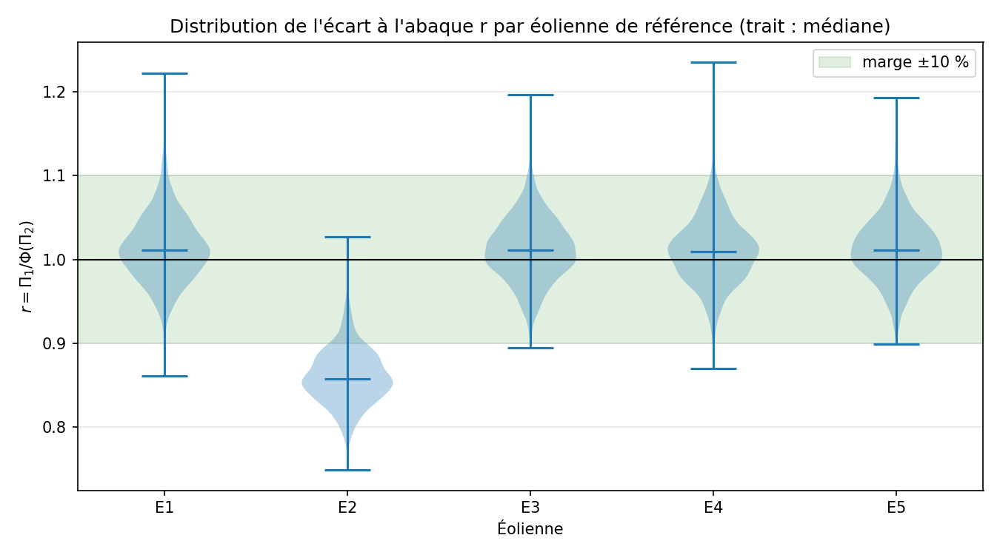

### Quelle éolienne est en panne ?

**E2.** Sa médiane de r vaut 0,857 : elle produit en moyenne 14 % de puissance de moins que ce que prévoit l'abaque pour son régime de fonctionnement, et 90 % de ses mesures sont hors de la marge. Les quatre autres éoliennes ont une médiane de 1,010 à 1,011 et seulement 1 à 2,5 % de mesures hors marge, ce qui correspond à la dispersion normale des mesures.

### Comment le voit-on, et pourquoi E2 n'a-t-elle pas faussé Φ ?

On le voit sur la figure 4 : la distribution de r de E2 est entièrement décalée vers le bas (son maximum dépasse à peine 1), alors que celles de E1, E3, E4 et E5 sont centrées sur 1 et presque entièrement dans la bande verte. Sur le nuage de la partie 08, cela se traduit par une bande de points séparée sous la courbe commune.

E2 n'a pas faussé Φ parce qu'elle ne représente qu'**une éolienne sur cinq, soit environ 20 % des points de chaque tranche**, et que Φ est une médiane : tant que les points anormaux restent minoritaires (moins de 50 %), la médiane de chaque tranche est fixée par les éoliennes saines. L'influence de E2 n'est cependant pas strictement nulle : les éoliennes saines ont une médiane de r de 1,011 et non de 1,000. Ce biais de 1 % est la trace résiduelle de E2 dans la médiane, à comparer aux 2 % environ qu'elle aurait introduits dans une moyenne. Il reste dix fois plus petit que la marge de ±10 % et ne change aucun diagnostic. On pourrait l'annuler en reconstruisant Φ sans E2, maintenant qu'elle est identifiée.

# Surveillance de la ferme en continu (parties 12 à 17)

## Partie 12 — Un topic pour les groupes Π

### Objectif

Créer le topic `ferme.eoliennes.pi` (6 partitions) et un job Spark Structured Streaming qui lit en continu `ferme.eoliennes`, calcule Π1 et Π2 pour chaque mesure à partir du ρ ajouté en partie 04, et les écrit dans `ferme.eoliennes.pi` avec le nom de l'éolienne comme clé.

### Méthode et implémentation

Le topic a été créé avec l'outil `kafka-topics.sh` du conteneur Kafka, ce qui est équivalent au bouton « Add a Topic » de Kafka UI : `--topic ferme.eoliennes.pi --partitions 6 --replication-factor 1` (la création automatique des topics est désactivée dans le `docker-compose.yml`).

Le job `12_spark_pi.py` (PySpark 4.0.1, connecteur `spark-sql-kafka-0-10_2.13:4.0.1` préinstallé dans l'image) :

1. lit `ferme.eoliennes` en flux (`readStream.format("kafka")`, `startingOffsets=earliest`) ;
2. décode la valeur avec `from_json` et un schéma explicite (`eolienne`, `zone`, `horodatage`, `seq`, `diametre_m`, `vent_ms`, `rotation_rads`, `puissance_w`, `rho_kgm3`) ; un message illisible donne une structure nulle et est filtré ;
3. calcule `pi1 = try_divide(puissance_w, rho_kgm3 · vent_ms³ · diametre_m²)` et `pi2 = try_divide(rotation_rads · diametre_m, vent_ms)`. Spark 4 active par défaut le mode ANSI, dans lequel une division par zéro lève une erreur et arrêterait le flux ; `try_divide` renvoie null à la place, de même qu'un champ absent ;
4. écrit dans `ferme.eoliennes.pi` la clé (clé d'origine, ou à défaut le champ `eolienne`) et la valeur `to_json(struct(eolienne, zone, horodatage, seq, pi1, pi2))` ;
5. conserve sa progression dans un *checkpoint* (`checkpoints/12_spark_pi`), avec un déclenchement toutes les 5 s.

Exemple de message produit : `E5 → {"eolienne":"E5","zone":"champs","horodatage":"2026-11-09T08:31:45.000+00:00","seq":43726,"pi1":0.0,"pi2":0.0}` (éolienne à l'arrêt à ce moment-là).

### Résultats

Le job a tourné en continu à partir de 08:31 UTC : l'interface Spark indique une entrée moyenne de 15,5 mesures/s (les quinze éoliennes) et une capacité de traitement de 42,5 mesures/s. Le topic contenait 12 108 messages Π à 08:39 et plus de 52 000 en fin de session.

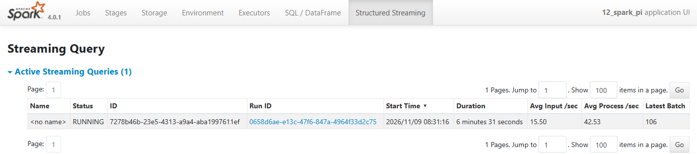

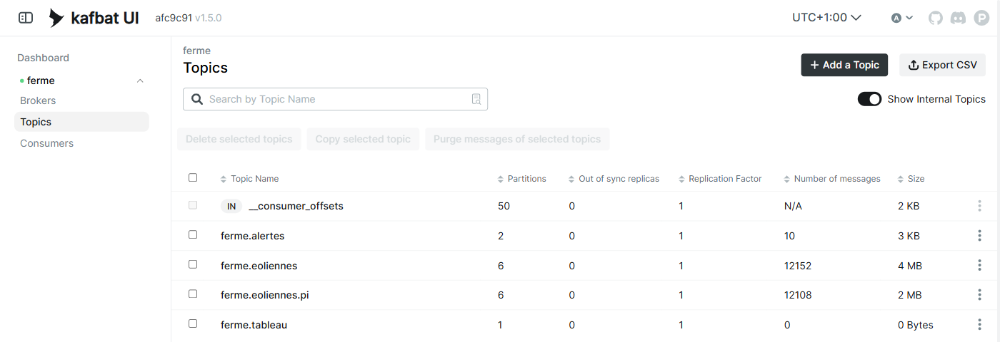

**Incident réel et correction.** À 09:08 UTC, le poste s'est mis en veille pendant 25 minutes. À la reprise, le job 12 s'était arrêté sur `TimeoutException: Timeout of 60000ms expired before the position for partition ferme.eoliennes-3 could be determined` : en mode `local`, Spark abandonne la requête au premier échec de tâche. Le job a été relancé : grâce au checkpoint, il a repris exactement au dernier offset traité, sans doublon ni trou. Pour la suite, le maître Spark est configuré en `local[2,4]` (4 tentatives par tâche), ce qui permet de survivre à une indisponibilité passagère de Kafka. Les mesures publiées sur MQTT pendant la veille n'ont pas pu être reçues : **les données réelles présentent un trou de 09:08 à 09:33 UTC**, visible sur les graphiques temporels.

### Pourquoi faire ce calcul dans un job séparé plutôt que dans le pont ?

- **Séparation des responsabilités.** Le pont a une seule mission critique : ne perdre aucune mesure. Plus il fait de calculs, plus il risque de planter ou de prendre du retard sur MQTT, qui ne conserve pas les messages. ρ est une simple conversion de la mesure brute ; Π1 et Π2 relèvent déjà de la modélisation.
- **Rejouabilité et évolutivité.** `ferme.eoliennes` conserve les mesures brutes enrichies. Si l'on change la définition des Π (par exemple λ = ωR/V au lieu de ωD/V), il suffit de relancer le job depuis le début du topic, sans rien demander aux capteurs. Un calcul fait dans le pont serait figé dans des messages déjà publiés.
- **Passage à l'échelle et tolérance aux pannes.** Spark répartit le calcul sur les 6 partitions et reprend exactement là où il s'était arrêté grâce à son checkpoint, ce qu'illustre l'incident ci-dessus ; un pont Python est un processus unique.
- **Mutualisation.** Les parties 13, 15, 16 et 17 lisent toutes `ferme.eoliennes.pi` : le calcul est fait une seule fois au lieu d'être recopié dans chaque consommateur, ce qui supprime le risque de définitions divergentes.

## Partie 13 — Surveiller E6 à E15

### Objectif

Faire tourner simultanément la chaîne MQTT → `ferme.eoliennes` → `ferme.eoliennes.pi`, lire `ferme.eoliennes.pi` en continu, garder les 60 dernières mesures de chaque éolienne de E6 à E15 et, toutes les 10 s, lui attribuer un état ; publier une alerte dans `ferme.alertes` à chaque changement d'état.

### Méthode et implémentation

Le pont 04 et le job 12 tournaient chacun dans leur processus. `13_surveiller.py` consomme `ferme.eoliennes.pi` et range les couples (Π1, Π2) dans une file de longueur fixe (`deque(maxlen=60)`) par éolienne. Toutes les 10 s, la fonction partagée `commun.etat` applique les règles de l'énoncé, dans cet ordre de priorité :

| État | Condition sur les 60 dernières mesures |
|---|---|
| HORS_ABAQUE | plus de 30 mesures (plus de la moitié) ont un Π2 absent de la table Φ (tranche non retenue, ou Π2 manquant) |
| SOUS_PRODUCTION | médiane de r < 0,9 (calculée sur les mesures dont r est défini) |
| SUR_PRODUCTION | médiane de r > 1,1 |
| OK | sinon |

Le premier état connu de chaque éolienne est aussi publié (ancien état `null`). Une alerte est un message JSON de clé égale au nom de l'éolienne, par exemple : `{"eolienne": "E12", "ancien_etat": "SOUS_PRODUCTION", "nouvel_etat": "OK", "mediane_r": 0.918, "hors_abaque": 0, "r_sup_2": 1, "taille_fenetre": 60, "derniere_mesure": "…", "emise_a": "…", "source": "13_surveiller"}`. Au démarrage, la première évaluation n'a lieu qu'une fois l'historique du topic relu, pour ne pas juger sur des fenêtres incomplètes ou anciennes.

### Résultats

**Exécution en direct** de 09:03:25 à 09:06:35 UTC (190 s, 19 évaluations). Alertes publiées dans `ferme.alertes` :

| Heure (UTC) | Éolienne | Transition | Médiane de r |
|---|---|---|---|
| 09:03:35 | E7 | — → SOUS_PRODUCTION | 0,649 |
| 09:03:36 | E10 | — → SOUS_PRODUCTION | 0,757 |
| 09:03:36 | E12 | — → SOUS_PRODUCTION | 0,882 |
| 09:03:35-36 | E6, E8, E9, E11, E13, E14, E15 | — → OK | 0,93 à 1,02 |
| 09:03:46 | E12 | SOUS_PRODUCTION → OK | 0,918 |
| 09:03:56 | E12 | OK → SOUS_PRODUCTION | 0,896 |
| 09:04:45 | E13, E14, E15 | OK → HORS_ABAQUE | 31 à 34 mesures hors abaque |
| 09:05:16 | E12 | SOUS_PRODUCTION → OK | 0,947 |
| 09:05:36 | E13, E14, E15 | HORS_ABAQUE → OK | — |

Pour juger sur une durée plus représentative que trois minutes, les mêmes règles (même fonction `commun.etat`) ont été rejouées sur tout l'historique de 08:30 à 09:08 UTC, avec une fenêtre de 60 mesures évaluée toutes les 10 mesures (`results/logs/rejeu_etats.py`, 232 évaluations par éolienne) :

| Éolienne | OK | SOUS_PRODUCTION | SUR_PRODUCTION | HORS_ABAQUE |
|---|---|---|---|---|
| E6 | 87,9 % | 0 % | 5,2 % | 6,9 % |
| E7 | 6,9 % | **87,5 %** | 0 % | 5,6 % |
| E8 | 93,5 % | 0 % | 0 % | 6,5 % |
| E9 | 92,7 % | 0 % | 0 % | 7,3 % |
| E10 | 6,5 % | **86,6 %** | 0 % | 6,9 % |
| E11 | 92,2 % | 0 % | 0 % | 7,8 % |
| E12 | 39,2 % | **53,9 %** | 0 % | 6,9 % |
| E13 | 98,3 % | 0 % | 0 % | 1,7 % |
| E14 | 96,6 % | 0 % | 0 % | 3,4 % |
| E15 | 97,0 % | 0 % | 0 % | 3,0 % |

Médiane de r par tranche de 5 minutes (extrait) :

| Éolienne | 08:30 | 08:40 | 08:50 | 09:00 | 09:35 |
|---|---|---|---|---|---|
| E7 | 0,670 | 0,636 | 0,562 | 0,663 | 0,675 (09:05) |
| E10 | 0,759 | 0,760 | 0,760 | 0,756 | 0,761 (09:05) |
| E12 | 0,852 | 0,924 | 0,867 | 0,866 | 0,947 (09:05) |
| E14 | 0,930 | 0,932 | 0,933 | 0,928 | 0,931 (09:05) |
| E6, E8, E9, E11, E13, E15 | 1,00 à 1,02 | 1,00 à 1,01 | 1,01 | 1,00 à 1,01 | 1,01 |

### Quelles éoliennes sont dans un état autre que OK ?

- **E7** et **E10** : en SOUS_PRODUCTION de façon quasi permanente (87 % du temps), avec des médianes respectives d'environ 0,65 et 0,76.
- **E12** : alternance entre SOUS_PRODUCTION et OK (54 % / 39 %), médiane entre 0,85 et 0,95, juste autour du seuil de 0,9.
- **E13, E14, E15** (plateau) : brièvement HORS_ABAQUE à 09:04:45 ; à ce moment, le vent moyen sur le plateau était de 3,7 m/s et 136 des 228 mesures de la minute étaient des arrêts.
- **E6** : SUR_PRODUCTION pendant 5 % des évaluations seulement (voir partie 15).
- Toutes les éoliennes passent quelques pour cent du temps en HORS_ABAQUE, lors des épisodes de vent faible.

### Que signifie physiquement chaque état ?

**SOUS_PRODUCTION (r < 1).** À régime aérodynamique égal (même Π2), l'éolienne convertit une plus faible part de l'énergie du vent que ses semblables. Causes possibles : dégradation des pales (érosion du bord d'attaque, encrassement, givre), mauvais calage des pales (*pitch*), désalignement de la nacelle par rapport au vent (*yaw*, la puissance chutant à peu près comme cos³ de l'angle), pertes mécaniques (roulements, multiplicateur), défaut de la génératrice ou du convertisseur, bridage volontaire de la puissance, ou encore erreur de mesure (anémomètre qui surestime le vent : 3 % d'erreur sur V donnent environ 9 % sur V³). Les profils diffèrent : **E10** perd 24 % de façon parfaitement constante, ce qui évoque un défaut permanent (bridage, calage, désalignement) ; **E7** perd environ 35 % avec une dispersion énorme (r de 0,1 à 2,5 sur le tableau de bord, figure 7), signe d'un fonctionnement erratique, probablement combiné à une mesure défaillante ; **E12** fluctue entre −5 % et −15 %, ce qui ressemble à un défaut intermittent. **E14**, à 0,93 en permanence, reste OK au sens de la règle mais produit systématiquement 7 % de moins que la référence : le seuil de ±10 % ne la signale pas.

**Une éolienne peut-elle produire plus que Φ ?** Ponctuellement oui, et c'est normal : Φ est la *médiane* des éoliennes saines, donc la moitié de leurs mesures sont au-dessus, avec une dispersion de quelques pour cent (rafales, inertie du rotor). En revanche, une médiane durablement supérieure à 1,1 n'est pas plausible pour une machine de la même famille. Les éoliennes de référence fonctionnent déjà près de leur optimum (C_p ≈ 0,455 au sommet de la courbe), et la limite de Betz (C_p ≤ 0,593, soit Π1 ≤ 0,233) interdit au sommet tout r supérieur à 0,233/0,179 ≈ 1,30. **Un r durablement supérieur à 1 révèle donc d'abord une erreur de mesure** (vent sous-estimé, puissance surestimée, ρ faux, diamètre mal renseigné) ou une machine d'une conception différente de la référence, pour laquelle l'abaque n'est pas valable. Les passages de E6 en SUR_PRODUCTION coïncident avec des mesures aberrantes (partie 15).

**HORS_ABAQUE.** Plus de la moitié des mesures ont un Π2 dans une zone où la table Φ n'a pas de valeur : rotor à l'arrêt (Π2 = 0, vent inférieur à 3 m/s ou supérieur à 25 m/s), régime de rotation jamais observé sur les éoliennes de référence, ou Π2 non calculable. **On ne peut pas conclure à une panne** : on ne sait simplement pas juger. Dans les cas observés (plateau à 09:04, vallée par vent faible), il s'agissait d'arrêts normaux par manque de vent. Une éolienne arrêtée alors que le vent est compris entre 3 et 25 m/s serait en revanche suspecte : il faudrait croiser l'état avec la vitesse du vent.

### Pourquoi juger sur la médiane de 60 mesures plutôt que sur chaque mesure ?

Une mesure isolée est bruitée : rafales, inertie du rotor (la puissance suit le vent avec retard), bruit des capteurs. Même pour les éoliennes saines de référence, 1 à 2,5 % des mesures sortent de la marge de ±10 % (partie 11). Juger chaque mesure produirait, sur dix éoliennes à 1 Hz, une dizaine de fausses alertes par minute. La médiane sur 60 mesures (une minute) filtre ce bruit et reste insensible aux valeurs aberrantes minoritaires, ce qui rend les états stables.

**Défaut que cette méthode laisse passer :** tout ce qui touche moins de la moitié de la fenêtre. D'abord les **défauts ponctuels ou intermittents** : mesures aberrantes isolées (E7, E12) ou épisodes courts (E6 : 30 s toutes les 7 minutes, soit au plus la moitié de la fenêtre, d'où seulement 5 % d'évaluations signalées). Ensuite les **dérives lentes et faibles** qui restent dans la marge (E14 à −7 %). Enfin, toute détection arrive avec un retard de l'ordre de 30 s, le temps que le défaut occupe la moitié de la fenêtre.

### L'abaque Φ, construit sur 5 éoliennes, est-il valable pour les autres ?

Les résultats montrent qu'il se transpose bien : les éoliennes saines E8, E9, E11, E13 et E15, de 5 à **20 m** de diamètre, situées dans les zones colline et plateau (ρ jusqu'à 12 % plus faible, vents jusqu'à 35 m/s), ont une médiane de r comprise entre 1,00 et 1,02. C'est la propriété de similitude : Π1 et Π2 absorbent les effets de taille, de densité et de vitesse. Ses limites sont les suivantes :

- **similitude géométrique et de pilotage** : Φ ne vaut que pour des rotors de même forme (profil et nombre de pales, vrillage) et de même loi de régulation. Une éolienne d'un autre modèle aurait sa propre courbe ;
- **effets d'échelle négligés** : l'analyse a écarté la viscosité de l'air, donc le nombre de Reynolds. À vent égal, il est proportionnel au diamètre : pour E15 (D = 20 m), il est 2,5 à 7 fois plus grand que pour les éoliennes de référence (D de 3 à 8 m), et un grand rotor a en général un C_p légèrement meilleur, ce qui biaise r vers le haut ;
- **domaine couvert** : Φ n'est défini que pour Π2 ∈ [6 ; 22,5[ et n'a été calibré qu'avec des vents de 0 à 18 m/s ;
- **biais de construction** : Φ est environ 1 % trop bas à cause de E2 (partie 11) ;
- **représentativité temporelle** : 33 minutes de mesures, un seul jour, sans givre ni vieillissement, et des mesures à 1 Hz interprétées comme des états d'équilibre, alors que le rotor a de l'inertie ;
- **conditions non modélisées** : turbulence, cisaillement du vent avec la hauteur et effets de relief propres à chaque zone n'entrent pas dans Π1 et Π2.

## Partie 14 — Décision

En croisant la partie 11 (éoliennes de référence) et les parties 13, 16 et 17 (surveillance) :

| Priorité | Éolienne | Constat | Intervention proposée |
|---|---|---|---|
| 1 | **E7** (D = 8 m) | SOUS_PRODUCTION permanente, r ≈ 0,65 (−35 %), dispersion énorme et nombreuses mesures r > 2 (état CAPTEUR) | Inspection complète : chaîne de production (calage, orientation, génératrice) **et** capteurs (anémomètre, mesure de puissance) |
| 1 | **E10** (D = 8 m) | SOUS_PRODUCTION permanente et très stable, r ≈ 0,76 (−24 %) | Inspection de la chaîne de production : bridage, calage des pales, alignement de la nacelle |
| 2 | **E12** (D = 12 m) | Alternance SOUS_PRODUCTION / OK, r de 0,85 à 0,95, mesures aberrantes isolées | Inspection : défaut intermittent probable ; l'enjeu énergétique est important vu le diamètre |
| 2 | **E2** (D = 5 m, référence) | r = 0,857 stable (−14 %), 90 % des mesures hors marge | Inspection de la chaîne de production ; la retirer du jeu de référence et reconstruire Φ |
| 3 | **E6** (D = 5 m) | Production normale (r ≈ 1,01), mais épisodes réguliers de mesures fausses (30 s toutes les 7 min) | Maintenance de l'instrumentation et de l'acquisition, sans urgence pour la production |
| Surveiller | **E14** (D = 12 m) | r = 0,93 constant, dans la marge donc OK | Pas d'intervention immédiate, contrôle lors de la prochaine maintenance |
| Aucune | E13, E14, E15 (HORS_ABAQUE) | Arrêts par vent faible ou trop fort | Aucune : fonctionnement normal |

L'ordre de priorité tient compte de l'énergie perdue, proportionnelle à D² × (1 − r) à vent égal : E7 (64 × 0,35 ≈ 22), E10 (64 × 0,24 ≈ 15), E12 (144 × ~0,10 ≈ 14), E14 (144 × 0,07 ≈ 10), E2 (25 × 0,14 ≈ 3,5). Ces valeurs sont des ordres de grandeur, car les vents diffèrent d'une zone à l'autre. Les éoliennes à intervention prioritaire sont donc **E7, E10, E12 et E2**, auxquelles s'ajoute une intervention sur l'instrumentation de **E6**.

## Partie 15 — Suivre r dans le temps

### Objectif

Fournir un tableau de bord qui affiche en direct, pour les éoliennes choisies, r de chaque mesure en fonction du temps, sa médiane glissante sur 60 mesures et la marge de ±10 %, avec une mise à jour toutes les 5 s.

### Méthode et implémentation

`15_tableau_r.py` utilise **Streamlit** (déjà présent dans `requirements.txt`). Des fils d'exécution de fond, créés une seule fois (`st.cache_resource`), consomment `ferme.eoliennes.pi` depuis le début (jusqu'à 3600 mesures par éolienne), la fin de `ferme.eoliennes` (grandeurs physiques) et `ferme.alertes`. Un fragment Streamlit (`st.fragment(run_every=5)`) se réexécute toutes les 5 s : pour chaque éolienne choisie, il calcule r, la médiane glissante sur 60 mesures (`rolling(60).median()`) et trace la série temporelle selon l'heure capteur (UTC), avec la bande de ±10 %. Les valeurs supérieures à l'échelle choisie sont écrêtées et marquées d'un triangle. L'état de toutes les éoliennes est calculé par la même fonction que les parties 13 et 16 (`commun.etat`). Le choix des éoliennes, de la période et de l'échelle se fait dans la barre latérale ou par l'URL (`?eoliennes=E6,E7&minutes=80`). Le tableau de bord est accessible sur `http://localhost:8501`.

La version finale de l'interface (« Wind Turbine Monitoring », annexe F) organise le tableau de bord en cinq vues : **Overview** (indicateurs clés, carte de l'éolienne sélectionnée, graphique r(t), grandeurs physiques mesurées), **Wind Farm** (tableau des 15 éoliennes, médianes, comparaison de plusieurs éoliennes), **Real-time Monitoring** (graphique demandé par l'énoncé et grandeurs physiques), **Alerts & Anomalies** (états, règles appliquées, historique de `ferme.alertes`) et **Data Quality** (fraîcheur et complétude des données, EX1 à EX5 séparées des éoliennes réelles). La présentation est isolée dans le paquet `scripts/tdb/` (données, thème, graphiques Altair, composants) ; aucun calcul ni seuil n'y est redéfini, ce que vérifie un test dédié. Deux choix ont été dictés par l'honnêteté des données : la puissance nominale n'étant pas publiée, la jauge circulaire porte sur le coefficient de puissance C_p = (8/π)·Π1 rapporté à la limite de Betz, et signale comme physiquement impossible toute valeur au-delà ; aucune température de composant (rotor, roulements) n'est affichée, car les capteurs ne la fournissent pas.


### Observez E6 : quel défaut l'évolution de r dans le temps met-elle en évidence ?

En dehors de certains moments, E6 est parfaitement normale : r reste dans la marge, avec une médiane de 1,00 à 1,02 sur chaque tranche de 5 minutes. Mais **toutes les 7 minutes exactement, pendant environ 30 secondes, r bondit au-delà de 2**, et la médiane glissante monte alors jusqu'à 1,5-1,6. L'analyse de l'historique (`results/logs/analyse_episodes.log`) donne des épisodes débutant à 08:31:00, 08:38:00, 08:45:09, 08:52:00 et 08:59:00 UTC, puis à nouveau à 09:06, 09:34 et 09:41, soit 118 mesures à r > 2 sur 1829. Il s'agit d'un **défaut intermittent et périodique**. Sa régularité parfaite et son caractère tout ou rien (r passe brutalement de 1 à plus de 2, puis revient) désignent un problème de mesure ou d'acquisition (capteur de vent ou de puissance, cycle d'un équipement) plutôt qu'un phénomène aérodynamique : un rotor ne peut pas doubler son rendement pendant 30 s puis revenir exactement à la normale.

### Le tableau de la partie 13 permettait-il de le voir ?

**Presque pas.** La partie 13 n'affiche qu'un état instantané, calculé sur la médiane des 60 dernières mesures. Un épisode de 30 s occupe au plus la moitié de la fenêtre : la médiane ne franchit le seuil de 1,1 que pendant les quelques secondes où la fenêtre contient tout l'épisode. Sur l'historique, E6 n'est en SUR_PRODUCTION que dans 5,2 % des évaluations, et le test en direct de 190 s n'a produit aucune alerte pour elle. Surtout, un état n'a pas de mémoire : même lorsqu'une alerte SUR_PRODUCTION brève apparaît, rien ne montre qu'elle se répète toutes les 7 minutes. C'est la **représentation temporelle** du tableau de bord qui révèle la périodicité.

## Partie 16 — Détecter les défauts ponctuels

### Objectif

Ajouter à la surveillance un état CAPTEUR, prioritaire sur la sous- et la sur-production, déclenché dès qu'au moins une mesure de la fenêtre a un r supérieur à 2.

### Méthode et implémentation

`16_surveiller_capteur.py` réutilise intégralement la partie 13 en activant `capteur=True` dans `commun.etat`. L'ordre de priorité devient HORS_ABAQUE > CAPTEUR > SOUS_PRODUCTION > SUR_PRODUCTION > OK. HORS_ABAQUE reste prioritaire, car l'énoncé ne place CAPTEUR qu'au-dessus de la sous- et de la sur-production. Le nombre de mesures r > 2 de la fenêtre est joint à chaque alerte (`r_sup_2`).

### Résultats

Exécution en direct de 09:03 à 09:06 UTC : **E7** → CAPTEUR et **E12** → CAPTEUR dès la première évaluation, E12 alternant ensuite entre CAPTEUR et SOUS_PRODUCTION, puis **E6 : OK → CAPTEUR à 09:06:07**, au moment précis de son épisode périodique de 09:06. Sur le rejeu de l'historique, les éoliennes en CAPTEUR sont **E7 (82 % des évaluations), E12 (42 %) et E6 (15,5 %)** ; aucune autre éolienne n'a jamais eu de r > 2 (`analyse_episodes.log` : 102 mesures r > 2 pour E7, 22 pour E12, 118 pour E6, 0 pour les autres).

### Pourquoi un r supérieur à 2 révèle-t-il une mesure fausse ?

- **Statistiquement** : la dispersion des éoliennes saines autour de Φ est de quelques pour cent ; un écart d'un facteur 2 est sans commune mesure avec ce bruit.
- **Physiquement** : à Π2 donné, Π1 est fixé par l'aérodynamique du rotor. Doubler la puissance extraite à régime égal supposerait de doubler le rendement aérodynamique. Près du sommet de la courbe (Φ ≈ 0,18), r = 2 donnerait Π1 ≈ 0,36, au-delà de la limite de Betz (0,233) : c'est impossible. On a d'ailleurs relevé dans les données un Π1 de 0,72, soit trois fois cette limite.
- **Dynamiquement** : les valeurs r > 2 apparaissent et disparaissent d'une seconde à l'autre, entourées de valeurs normales. Le rotor a une inertie : sa puissance ne peut pas doubler puis revenir en une seconde.

La cause la plus probable est une erreur sur l'une des grandeurs du calcul : un vent sous-estimé de 21 % suffit à doubler V³ (0,79³ ≈ 0,5), donc à doubler Π1. Un pic sur la mesure de puissance ou une erreur de transmission produirait le même effet.

### Pourquoi combiner la médiane et ce comptage ?

Les deux indicateurs voient des choses complémentaires. La **médiane** décrit le comportement *typique* : elle détecte les défauts de production durables (E7, E10, E12, E2) mais ignore, par construction, les valeurs extrêmes minoritaires. Le **comptage des r > 2** surveille la *queue* de la distribution : il détecte les défauts ponctuels de capteur que la médiane cache (E6, E12). Ni l'un ni l'autre ne suffit seul. CAPTEUR est prioritaire parce qu'une éolienne dont les capteurs donnent des valeurs fausses ne peut plus être jugée de façon fiable sur sa production. En contrepartie, l'état CAPTEUR masque la sous-production de E7 et E12 : c'est pourquoi chaque alerte transporte aussi la médiane de r, afin que l'opérateur dispose des deux informations.

## Partie 17 — Indicateurs par minute avec Spark

### Objectif

Écrire un job Spark Structured Streaming qui lit `ferme.eoliennes.pi`, calcule r pour chaque mesure, puis, par éolienne et par minute (heure des capteurs, watermark de 2 minutes), le nombre de mesures, la médiane de r, le nombre de mesures suspectes (r > 2) et l'état, et qui publie un message par éolienne et par minute dans `ferme.tableau`.

### Méthode et implémentation

`17_spark_indicateurs.py` :

1. lit `ferme.eoliennes.pi` et convertit `horodatage` en *timestamp* avec `try_to_timestamp(…, "yyyy-MM-dd'T'HH:mm:ss.SSSXXX")` : c'est le **temps d'événement** ;
2. intègre la table Φ dans le plan de calcul sous forme de *map* littérale (33 entrées), et calcule `tranche = floor(pi2 / 0,5)`, `phi = try_element_at(map, tranche)`, puis `r = try_divide(pi1, phi)` ;
3. regroupe par éolienne et par fenêtre fixe d'une minute, `groupBy("eolienne", window("t", "1 minute"))`, après `withWatermark("t", "2 minutes")` ;
4. agrège `count`, `percentile_approx(r, 0.5)` (médiane), le nombre de r > 2 et le nombre de mesures hors abaque, puis déduit l'état avec les mêmes règles qu'en partie 16 ;
5. écrit en mode `append` dans `ferme.tableau` (clé = éolienne), avec un déclenchement toutes les 10 s et un checkpoint.

### Résultats

840 messages avaient été publiés en fin de session, un par éolienne et par minute. Exemple : `E11 → {"eolienne": "E11", "debut": "2026-11-09T09:05:00.000Z", "fin": "2026-11-09T09:06:00.000Z", "nb_mesures": 60, "mediane_r": 1.0035, "nb_suspects": 0, "nb_hors_abaque": 2, "etat": "OK"}`. Répartition des états par minute sur les 44 premières minutes (08:20-09:08) :

| Éolienne | OK | SOUS_PRODUCTION | CAPTEUR | HORS_ABAQUE | SUR_PRODUCTION |
|---|---|---|---|---|---|
| E2 | 5 | 34 | 0 | 5 | 0 |
| E6 | 36 | 0 | 5 | 3 | 0 |
| E7 | 5 | 3 | 32 | 3 | 1 |
| E10 | 5 | 37 | 0 | 2 | 0 |
| E12 | 12 | 13 | 17 | 2 | 0 |
| E1, E3, E4, E5, E8, E9, E11, E13, E14, E15 | 38 à 42 | 0 | 0 | 2 à 6 | 0 |

Ces résultats concordent avec ceux de la surveillance Python : E2, E7, E10 et E12 sont signalées, et E6 apparaît en CAPTEUR pendant 5 minutes, ce qui correspond à ses épisodes périodiques. Les 81 messages dont la médiane est nulle concernent les minutes sans aucun r calculable (mesures de la partie 02 sans ρ, éoliennes EX à champs manquants).

**Délai de publication mesuré** (heure d'écriture du message dans Kafka moins la fin de la minute) : de **141 à 146 s** pour toutes les fenêtres terminées après 09:34.

### Pourquoi découper selon l'heure des capteurs plutôt que selon l'heure d'arrivée dans Kafka ?

Une minute doit regrouper les mesures *prises* pendant cette minute. L'heure d'arrivée dans Kafka dépend de tout ce qui se passe entre le capteur et Kafka : latence réseau, mise en mémoire tampon du producteur, arrêt et redémarrage du pont, relecture de l'historique. Lors de la reprise après la veille, ou à chaque démarrage avec `startingOffsets=earliest`, des dizaines de minutes de mesures ont été traitées en quelques secondes : découpées selon l'heure d'arrivée, elles seraient toutes tombées dans la même minute, et la médiane aurait mélangé des conditions de vent sans rapport entre elles. Le temps d'événement rend le résultat déterministe et reproductible : rejouer le topic redonne exactement les mêmes indicateurs.

### Que se passe-t-il pour une mesure qui arrive plus de 2 minutes en retard ?

Spark maintient un watermark égal à la plus grande heure capteur déjà vue, moins 2 minutes. Dès que le watermark dépasse la fin d'une fenêtre, celle-ci est considérée comme complète : son résultat est publié (mode `append`) et son état intermédiaire est supprimé. Une mesure dont l'heure est antérieure au watermark, c'est-à-dire qui arrive plus de 2 minutes après des mesures plus récentes, est **ignorée silencieusement** : elle n'est comptée dans aucune fenêtre et aucune erreur n'est signalée. Une mesure en retard de moins de 2 minutes est, elle, correctement intégrée à sa minute. Le watermark est global au flux : c'est l'éolienne la plus « en avance » qui le fait progresser.

### Pourquoi les résultats n'apparaissent-ils qu'au bout de quelques minutes ?

En mode `append`, une fenêtre n'est publiée qu'une fois définitive, donc quand le watermark a dépassé sa fin : la minute [t, t + 1 min[ ne sort qu'après réception d'une mesure d'heure supérieure ou égale à t + 3 min. Le résultat d'une minute arrive donc **au moins 2 minutes après sa fin**, soit environ 3 minutes après son début. S'y ajoutent l'intervalle de déclenchement (10 s) et le fait que Spark calcule le nouveau watermark à la fin d'un micro-lot pour l'appliquer au suivant. Le délai mesuré, de 141 à 146 s après la fin de la minute, correspond exactement à ce calcul (120 s de watermark plus environ 20 s). Au tout premier démarrage s'ajoute le temps de traitement de l'historique.

# Robustesse aux données manquantes (partie 18)

## Partie 18 — Données manquantes

### Objectif

Prévoir puis observer l'effet de deux types de données manquantes sur chacun des scripts — un champ absent dans certaines mesures, et des mesures qui n'arrivent plus pendant un moment —, puis proposer des moyens de les détecter.

### Réponse a priori (rédigée avant d'exécuter la simulation)

Cette analyse a été écrite à partir du code, avant de lancer `18_simuler_manques.py`.

**Cas 1 — un champ absent dans certaines mesures.**

| Script | Effet attendu |
|---|---|
| 01, 02 | Aucun : les messages sont enregistrés ou recopiés tels quels, sans lecture des champs. |
| 04 (pont ρ) | Si `pression_hpa` ou `temp_c` manque, ρ n'est pas calculé ; la mesure est transmise sans `rho_kgm3` (pas de plantage, pas de perte). Les autres champs absents passent inaperçus. |
| 03, 08, 10, 11, 19 | Les mesures incomplètes sont écartées (Π non calculable) : moins de points, Φ inchangé tant que la proportion reste faible. |
| 12 (Spark Π) | `from_json` met le champ à null et `try_divide` propage le null : sans `puissance_w` ou `rho_kgm3`, Π1 est absent mais Π2 est calculé ; sans `vent_ms`, Π1 et Π2 sont tous deux absents. |
| 13 / 16 | Sans Π1 : r n'est pas calculable, la médiane porte sur les seules mesures complètes ; si aucune ne l'est, la médiane est indéfinie et l'éolienne reste **OK par défaut** (faux négatif). Sans Π2 (vent absent) : la mesure compte comme « absente de l'abaque » ; au-delà de la moitié de la fenêtre, l'éolienne passe **HORS_ABAQUE**, ce qui est un mauvais diagnostic (problème de capteur, pas de régime de fonctionnement). |
| 15 (tableau de bord) | Les mesures sans r disparaissent de la courbe : trous dans la série, médiane glissante calculée sur moins de points. |
| 17 (Spark minute) | `nb_mesures` compte toutes les mesures, mais la médiane de r ne porte que sur les mesures complètes ; un vent absent fait monter `nb_hors_abaque` et peut faire passer la minute en HORS_ABAQUE. |

**Cas 2 — des mesures qui n'arrivent plus pendant un moment.**

| Script | Effet attendu |
|---|---|
| 02 / 04 | Rien à transmettre : aucune erreur, aucune trace du silence dans Kafka. |
| 13 / 16 | La fenêtre des 60 dernières mesures n'est plus renouvelée : l'état est figé sur sa dernière valeur et **aucune alerte n'est émise** ; seul l'horodatage de la dernière mesure, affiché dans la console, vieillit. |
| 15 | La courbe s'arrête, sans message d'erreur. |
| 17 | Aucune mesure, donc aucune fenêtre : **aucun message** n'est publié pour cette éolienne pendant ces minutes. L'absence de message n'est pas une alerte. |
| Pertes partielles | Avec des mesures perdues de façon sporadique, la fenêtre de 60 mesures couvre une durée plus longue ; la médiane reste correcte, mais `nb_mesures` par minute diminue dans `ferme.tableau`. |

En résumé, la chaîne ne plante pas, mais **elle se tait** : aucun script ne signale explicitement qu'une donnée manque, et deux défauts peuvent être mal classés (OK par défaut, HORS_ABAQUE au lieu de CAPTEUR).

### Simulation

`18_simuler_manques.py` lit en continu les nouvelles mesures de E1 à E5 dans `ferme.eoliennes` et les republie dans ce même topic sous les noms EX1 à EX5, chacune abîmée différemment. Pour éviter toute boucle, le programme ignore les clés EX1 à EX5. Les tirages aléatoires utilisent une graine fixe (18), ce qui rend la simulation reproductible. **Les données EX1 à EX5 sont simulées** : elles sont dérivées des mesures réelles de E1 à E5, mais leurs défauts sont artificiels.

| Éolienne simulée | Source | Défaut simulé | Bilan du simulateur (09:33-09:46) |
|---|---|---|---|
| EX1 | E1 | mesures perdues (2 sur 3 en moyenne, au hasard) | 260 republiées sur 787 reçues (33 %) |
| EX2 | E2 | `puissance_w` absent dans 2 mesures sur 3 en moyenne | 787 / 787 |
| EX3 | E3 | `vent_ms` absent dans 2 mesures sur 3 en moyenne | 786 / 786 |
| EX4 | E4 | `rho_kgm3` absent dans 2 mesures sur 3 en moyenne | 786 / 786 |
| EX5 | E5 | silence : 2 min d'émission puis 3 min sans rien, en boucle | 326 / 786 (41 %) |

EX1 à EX5 ont été ajoutées aux éoliennes surveillées (`--eoliennes E6,…,E15,EX1,…,EX5`). Les parties 13 et 16 ont tourné de 09:35 à 09:46 UTC, pendant que les jobs Spark 12 et 17 et le tableau de bord fonctionnaient en continu.

### Observations script par script

| Script | Observation réelle |
|---|---|
| 02 / 04 (pont) | Aucun effet : les EX sont injectées directement dans Kafka par le simulateur, le pont MQTT ne les voit pas. |
| 12 (Spark Π) | Aucune erreur. Les valeurs nulles sont omises par `to_json` : 528 messages de EX2 et 543 de EX4 n'ont que Π2 ; 535 messages de EX3 n'ont ni Π1 ni Π2, par exemple `{"eolienne": "EX3", "zone": "vallee", "horodatage": "…09:08:30…", "seq": 45931}`. |
| 13 / 16 (surveillance) | **EX1** : OK (médiane 1,02), la perte de deux mesures sur trois est invisible, la fenêtre de 60 couvre simplement environ 3 minutes. **EX2** : SOUS_PRODUCTION (0,86), le défaut de E2 reste détecté à partir du tiers de mesures complètes, mais l'absence de puissance n'est pas signalée. **EX3** : HORS_ABAQUE en permanence (39 à 42 mesures sur 60 sans Π2), un problème de capteur classé comme un régime de fonctionnement. **EX4** : OK, l'absence de ρ est invisible. **EX5** : pendant le silence, l'état reste figé (OK, médiane 1,015) et aucune alerte n'est émise ; seule la dernière mesure, bloquée à 09:36:59 alors qu'il est 09:38:57, trahit le problème. EX1, EX2 et EX4 passent aussi par moments en HORS_ABAQUE, comme leurs sources de la vallée, à cause du vent faible et non du défaut simulé. |
| 15 (tableau de bord) | **Plantage du tableau de bord sur EX3** : pandas représente le Π2 absent par `NaN` et non par `None`, et `floor(NaN)` lève `ValueError: cannot convert float NaN to integer`. Ce défaut a été corrigé dans la fonction partagée (`commun.manquant`, qui traite None et NaN de la même façon), un test de non-régression a été ajouté, et le tableau de bord a été relancé. Ensuite : courbes clairsemées pour EX2 à EX4, et silence de EX5 visible comme un trou que la médiane glissante enjambe en ligne droite (figure 8). |
| 17 (Spark minute) | **EX1** : 17 à 26 mesures par minute au lieu de 60. **EX2 et EX4** : 60 mesures par minute, comme si de rien n'était. **EX3** : HORS_ABAQUE à chaque minute. **EX5** : **aucun message** pour les minutes de silence (09:37, 09:38, 09:39, puis 09:42, 09:43). |
| 08, 10, 11, 19 (batch) | Non concernés : ils ne lisent que les clés E1 à E5. |

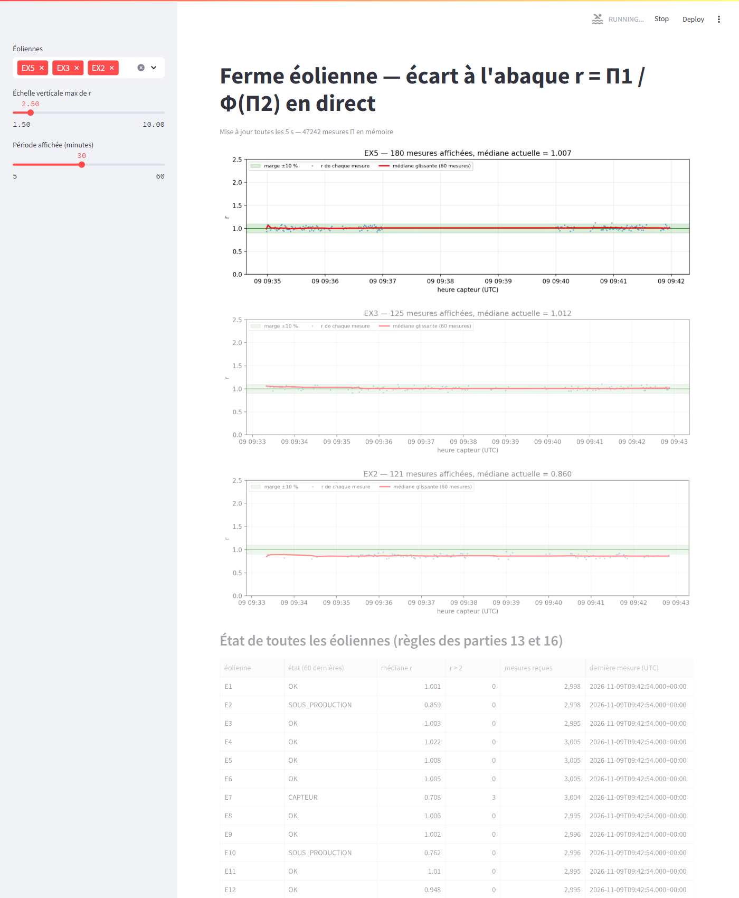

Une situation réelle a d'ailleurs reproduit le cas 2 à l'échelle de toute la ferme : la mise en veille du poste de 09:08 à 09:33 a interrompu la réception pendant 25 minutes. Aucun script n'a signalé ce trou ; on ne le voit qu'*a posteriori*, sur les courbes temporelles (figure 7).

### Comparaison avec la réponse initiale

Les prédictions se sont **vérifiées pour l'essentiel** : aucun plantage côté Kafka, Spark ou surveillance ; EX3 mal classée en HORS_ABAQUE ; état figé et absence d'alerte pendant le silence de EX5 ; aucune fenêtre Spark pour les minutes sans mesure ; nombre de mesures par minute réduit pour EX1. Deux points diffèrent :

1. **Le tableau de bord a planté**, alors que j'avais seulement prévu des trous dans la courbe. Le cas « champ absent » n'était géré que pour la valeur `None` des messages JSON : la conversion en DataFrame a introduit une autre représentation de l'absence (`NaN`), passée inaperçue. Le défaut est désormais corrigé et testé.
2. **Le cas « OK par défaut » ne s'est pas produit** pour EX2 et EX4, parce qu'il restait un tiers de mesures complètes : la médiane est calculée sur environ 20 mesures et donne le bon diagnostic (sous-production pour EX2, état sain pour EX4). Le risque prévu reste réel si la proportion de champs absents approche 100 % : c'est ce que montre le test unitaire `etat([(None, 6.0)] * 60) == "OK"`.

La conclusion générale est confirmée : **la chaîne ne plante plus, mais elle se tait**. Aucune donnée manquante n'est signalée explicitement.

### Comment pourrait-on détecter ces problèmes ?

- **Fraîcheur des données** (silence, EX5, veille du poste) : surveiller l'âge de la dernière mesure de chaque éolienne (heure courante moins heure capteur) et émettre un état `MUETTE` au-delà de quelques secondes. Dans Spark, comparer la liste des éoliennes attendues à celles présentes dans chaque minute (jointure avec une table de référence), ou utiliser un traitement à état avec délai d'expiration (`applyInPandasWithState`) pour publier une alerte quand une clé n'envoie plus rien.
- **Complétude** (mesures perdues, EX1) : le compteur `seq`, incrémenté chaque seconde, permet de compter exactement les mesures manquantes (sauts de `seq`). On peut aussi comparer `nb_mesures` à 60 dans `ferme.tableau` et déclencher un état `INCOMPLET` sous un seuil, par exemple 54 mesures (90 %).
- **Validité du schéma** (champs absents, EX2 à EX4) : valider les champs obligatoires dès le pont ou dans le job 12, publier les messages incomplets dans un topic de rejets (par exemple `ferme.eoliennes.rejets`) et compter, par fenêtre, les mesures sans puissance, sans vent ou sans ρ.
- **Distinguer les causes de HORS_ABAQUE** : séparer « Π2 absent » (problème de donnée, à classer en CAPTEUR ou INCOMPLET) de « Π2 hors du domaine » (régime non couvert), et croiser avec le vent mesuré (arrêt normal sous 3 m/s ou au-dessus de 25 m/s).
- **Robustesse du code** : traiter toute valeur manquante par une fonction unique (`commun.manquant`), tester les scripts avec des données dégradées (comme ici) et afficher dans le tableau de bord l'âge de la dernière mesure, en rouge au-delà d'un seuil.

# Fiabilité de l'abaque (partie 19)

## Partie 19 — Une seule éolienne suffit-elle ?

### Objectif

Refaire le graphique de la partie 08 pour E1 seule, en y superposant l'abaque construit sur E1 seule et l'abaque de référence (E1 à E5) ; puis étudier la convergence de Φ en fonction du nombre N de mesures utilisées, d'abord pour E1 seule, puis pour E1 à E5.

### Méthode et implémentation

`19_convergence.py` réutilise `points_par_eolienne` (partie 08) et `construire_phi` (partie 10), avec la même règle : tranches de 0,5, médiane, au moins 20 mesures, points d'arrêt exclus. Les mesures utiles sont prises **dans l'ordre chronologique** (tri sur `seq`) : pour E1 à E5, les N premières mesures sont donc celles des N/5 premières secondes de fonctionnement des cinq éoliennes. Pour N = 30, 60, 90, … jusqu'à toutes les mesures, on construit Φ_N et on calcule :

$$écart(N) = médiane sur les tranches communes de | Φ_N(k) / Φ_réf(k) − 1 |$$

On trace aussi le nombre de tranches retenues, qui mesure la couverture du domaine. L'abaque de référence est construit sur toutes les mesures de E1 à E5 disponibles au moment de l'exécution (09:03 UTC, 7519 mesures utiles, 33 tranches). Pour E1 à E5, la dernière valeur de la courbe est donc nulle par construction : Φ_N y coïncide avec Φ_réf.

### Résultats

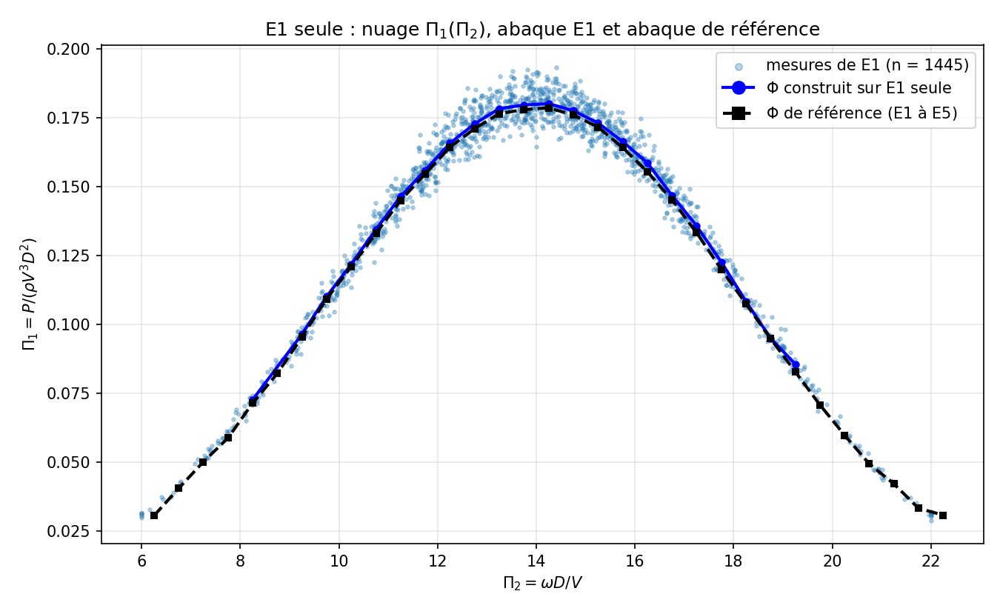

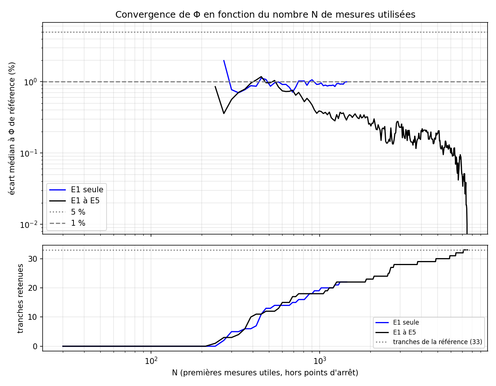

| N (mesures utiles) | E1 seule : écart | E1 seule : tranches | E1 à E5 : écart | E1 à E5 : tranches |
|---|---|---|---|---|
| 270 | 1,98 % | 2 | 0,36 % | 3 |
| 510 | 0,86 % | 13 | 0,97 % | 12 |
| 990 | 0,93 % | 19 | 0,39 % | 18 |
| 1440 | 1,00 % | 22 | 0,29 % | 22 |
| 3000 | — | — | 0,23 % | 28 |
| 6000 | — | — | 0,10 % | 31 |
| 7519 (tout) | — | — | 0 (référence) | 33 |

Avec toutes ses mesures (1445), E1 seule donne un abaque de 22 tranches (Π2 de 8 à 19,5) dont l'écart médian à la référence est de 1,0 %. La référence en compte 33 (Π2 de 6 à 22,5).

À titre de vérification complémentaire, chaque éolienne de référence a aussi servi seule à construire un abaque, comparé à la référence (exécution vers 09:50 UTC sur les mesures disponibles à ce moment, `results/logs/19_phi_par_eolienne.log`) : E1, E3, E4 et E5 donnent chacune un Φ supérieur de **+1,2 %** à la référence, tandis que **E2 seule donne un Φ inférieur de 14,2 %**.

### Cela aurait-il pu marcher en ne prenant qu'une éolienne ?

**Oui, mais par chance, et avec un domaine réduit.** E1 étant saine, son abaque se superpose à la référence à 1 % près (figure 9). Il est même un peu plus juste, puisqu'il ne contient pas le biais de E2. Deux problèmes subsistent :

- **on ne peut pas savoir si l'éolienne choisie est saine.** Si l'on avait pris E2, l'abaque aurait été faux de 14 % : E2 aurait été jugée normale et toutes les éoliennes saines auraient paru en SUR_PRODUCTION (r ≈ 1,17). Avec une seule machine, rien ne permet de détecter l'erreur, car il n'existe aucun point de comparaison ;
- **la couverture est plus faible** : 22 tranches au lieu de 33. Les régimes extrêmes (Π2 < 8 et Π2 > 19,5) sont trop rares sur une seule machine pour atteindre 20 mesures par tranche. Une éolienne surveillée qui fonctionnerait dans ces régimes serait déclarée HORS_ABAQUE.

### Quel avantage y a-t-il à avoir pris plusieurs éoliennes ?

- **Robustesse aux pannes** : avec cinq machines, une machine défaillante ne représente que 20 % des points et la médiane l'élimine presque complètement (biais résiduel de 1 % au lieu de 14 %). Elle devient en outre *détectable* par comparaison avec les autres (partie 11).
- **Couverture du domaine** : à durée égale, cinq éoliennes collectent cinq fois plus de mesures et voient des régimes plus variés (deux zones, trois diamètres) : 33 tranches au lieu de 22.
- **Rapidité** : pour obtenir 22 tranches, il faut N ≈ 1440 mesures dans les deux cas. Pour E1 seule, cela représente environ 24 minutes de fonctionnement ; pour E1 à E5, environ 5 minutes, puisque les cinq machines mesurent en parallèle.
- **Validation croisée** : l'accord entre les abaques individuels des éoliennes saines (+1,2 % chacune) démontre la propriété de similitude que suppose toute la méthode.

### À partir de combien de mesures l'abaque est-il stable ?

Il faut distinguer deux aspects.

- **La valeur de Φ dans les tranches couvertes** est stable très tôt. Dès qu'une tranche atteint 20 mesures, sa médiane est à moins de 2 % de la référence. L'écart médian est inférieur à 2 % dès N = 270 pour E1 seule et N = 240 pour E1 à E5, et il ne remonte jamais au-dessus. Pour E1 à E5, il décroît ensuite régulièrement : 0,4 % vers N = 1000, 0,2 % vers N = 3000, 0,1 % vers N = 6000. Pour E1 seule, il plafonne à environ 1 % : ce plancher n'est pas un manque de données, c'est l'écart systématique entre une éolienne saine et une référence légèrement biaisée par E2.
- **La couverture du domaine** converge beaucoup plus lentement, et c'est elle qui limite. Pour E1 à E5, il faut N ≈ 1140 mesures pour 20 tranches, N ≈ 4890 pour 30 tranches et N ≈ 7110 pour les 33 tranches de la référence. Les tranches des bords de la courbe sont rares, et la couverture dépend autant des conditions de vent rencontrées que du nombre de mesures.

En résumé, avec E1 à E5, **l'abaque est stable à mieux que 0,5 % sur la partie centrale (Π2 de 9 à 19) à partir d'environ 1000 à 1500 mesures**, soit quelques minutes de fonctionnement des cinq éoliennes. Il faut environ 7000 mesures, soit près d'une demi-heure de mesures, pour couvrir tout le domaine observé. La règle des 20 mesures par tranche est ce qui garantit cette stabilité : aucune tranche n'est retenue tant que sa médiane n'est pas fiable.

# Conclusion générale

## Synthèse du travail

Les dix-neuf parties du TD ont été réalisées sur les **données réelles** du broker de la ferme, le 9 novembre 2026, de 08:13 à 09:50 UTC environ. Les seules exceptions sont les éoliennes EX1 à EX5 de la partie 18, simulées à partir de ces mesures comme le demande l'énoncé. La chaîne complète MQTT → Kafka → Spark → surveillance → tableau de bord a fonctionné en continu, y compris après une interruption réelle de 25 minutes, absorbée grâce aux checkpoints Spark et à la reconnexion automatique du pont.

## Résultats importants

- L'analyse dimensionnelle (rang 3, n − r = 2) donne **Π1 = P/(ρV³D²)** et **Π2 = ωD/V**, c'est-à-dire, à un facteur près, le coefficient de puissance et la vitesse réduite en bout de pale. Les cinq éoliennes de référence, de 3 à 8 m de diamètre, se rangent sur **une seule courbe en cloche** de maximum Π1 ≈ 0,179 (C_p ≈ 0,455) pour Π2 ≈ 14 (λ ≈ 7).
- L'abaque Φ (33 tranches de Π2 entre 6 et 22,5) révèle que **E2 est en panne** (−14 %, 90 % des mesures hors marge), sans que sa présence ait faussé l'abaque de plus de 1 %, grâce à la médiane.
- La surveillance continue met en évidence trois éoliennes en **sous-production** : **E7** (−35 %, erratique), **E10** (−24 %, constante) et **E12** (−5 à −15 %, intermittente). Elle révèle aussi des **mesures fausses** sur E7, E12 et E6, cette dernière présentant un défaut parfaitement périodique (30 s toutes les 7 minutes) que seule la vue temporelle du tableau de bord rend évident. E14 (−7 %) reste sous le seuil.
- Les états HORS_ABAQUE observés correspondent tous à des arrêts normaux par vent faible (moins de 3 m/s) ou trop fort (plus de 25 m/s).
- Les indicateurs Spark par minute confirment ces diagnostics et sont publiés environ 2 min 20 s après la fin de chaque minute, conformément au watermark de 2 minutes.
- La simulation des données manquantes montre que la chaîne est robuste (aucun plantage côté flux), mais **silencieuse** face aux données absentes. Elle a aussi révélé et permis de corriger un vrai défaut du tableau de bord.

## Apports de l'architecture

Kafka découple la collecte des traitements : les mesures sont conservées, relisibles depuis le début et partagées entre des consommateurs indépendants (scripts d'analyse, surveillance, Spark, tableau de bord). Spark Structured Streaming apporte le calcul continu, le temps d'événement, la gestion des retards et la reprise sur incident grâce aux checkpoints. Regrouper le code commun dans `commun.py` garantit que tous les scripts appliquent exactement les mêmes définitions de Π, de Φ et des états.

## Intérêt de l'analyse dimensionnelle

Elle remplace un problème à cinq variables, avec des machines incomparables, par une relation universelle entre deux nombres. Un modèle construit sur cinq éoliennes de 3 à 8 m s'est ainsi révélé valable pour des éoliennes jusqu'à 20 m, sur d'autres zones, avec un air jusqu'à 12 % moins dense. Elle fournit en outre des garde-fous physiques (limite de Betz) qui justifient objectivement le seuil r > 2 de détection des mesures fausses.

## Limites rencontrées

- Durée d'observation courte (environ 1 h 20 de mesures, dont un trou de 25 min) : une seule situation météorologique, sans effet saisonnier ni vieillissement.
- Abaque légèrement biaisé (+1 %) par E2 ; effets d'échelle (nombre de Reynolds), turbulence et relief non modélisés.
- Le seuil de ±10 % laisse passer les dégradations faibles (E14) ; la médiane sur 60 mesures laisse passer les défauts courts.
- Absence de détection explicite des données manquantes (partie 18).
- La purge du topic `ferme.eoliennes` demandée en partie 04 a été réalisée après coup, et non avant le lancement du pont enrichi (voir partie 04) ; elle est sans effet sur les résultats.

## Améliorations possibles

- Reconstruire Φ sans E2, puis le mettre à jour périodiquement avec les seules éoliennes jugées saines.
- Ajouter des états `MUETTE` et `INCOMPLET` (fraîcheur, sauts de `seq`, champs manquants) et un topic de rejets.
- Compléter la médiane par des indicateurs de tendance (médiane glissante sur 1 h, test de rupture) pour détecter les dérives lentes comme celle de E14, et par une détection de périodicité pour les défauts du type de E6.
- Utiliser une session MQTT persistante pour ne rien perdre pendant un arrêt du pont, et un *watchdog* qui relance automatiquement les jobs.

# Annexes

## Annexe A — Arborescence du projet

```
TD_Ferme_Eolienne/
├── README.md, docker-compose.yml, Dockerfile, requirements.txt, .env.exemple, .gitignore
├── td-ferme-eolienne-enonce.pdf
├── scripts/      commun.py, 01_mqtt.py … 19_convergence.py (15 scripts, noms imposés)
├── data/         topics.jsonl, mesures.jsonl (partie 01)
├── results/
│   ├── graphiques/   puissance_vent.png, pi1_pi2.png, phi.png, r_par_eolienne.png, phi_e1.png, convergence.png
│   ├── tableaux/     phi.json, phi_detail.csv, r_par_eolienne.csv, convergence.csv,
│   │                 ferme_alertes.jsonl, ferme_tableau.jsonl
│   ├── captures/     dashboard_overview.png, dashboard_wind_farm.png, dashboard_temps_reel.png,
│   │                 dashboard_alertes.png, dashboard_qualite_donnees.png (interface finale),
│   │                 tableau_de_bord_E6_E7.png, tableau_de_bord_EX_silence.png (première version),
│   │                 kafka_ui_topics.png, spark_ui_12_streaming.png
│   └── logs/         sorties réelles de chaque script et scripts d'analyse complémentaires
├── report/       Compte_Rendu_TD_Ferme_Eolienne.docx / .md, sections/, construire_docx.js
└── tests/        test_mqtt_connection.py, test_calculs.py
```

## Annexe B — Commandes d'exécution

```
docker compose up -d --build
docker compose exec kafka /opt/kafka/bin/kafka-topics.sh --bootstrap-server localhost:9092 \
    --create --topic ferme.eoliennes.pi --partitions 6 --replication-factor 1
docker compose exec app python tests/test_mqtt_connection.py 10
docker compose exec app python scripts/01_mqtt.py 30
docker compose exec app python scripts/04_pont_masse_volumique.py      # terminal 1
docker compose exec app python scripts/12_spark_pi.py                  # terminal 2
docker compose exec app python scripts/10_phi_construire.py            # après 30 à 60 min
docker compose exec app python scripts/16_surveiller_capteur.py        # terminal 3
docker compose exec app python scripts/17_spark_indicateurs.py         # terminal 4
docker compose exec app streamlit run scripts/15_tableau_r.py --server.port 8501 --server.address 0.0.0.0
docker compose exec app python tests/test_calculs.py
```

Le README détaille l'ensemble des commandes, partie par partie, ainsi que les commandes de vérification de Kafka (`kafka-topics.sh --describe`, `kafka-get-offsets.sh`, `kafka-console-consumer.sh`).

## Annexe C — Dépendances

| Composant | Version | Rôle |
|---|---|---|
| Python | 3.12 (image `python:3.12-slim-trixie`) | langage des scripts |
| Java | OpenJDK 21 | exécution de Spark |
| Apache Kafka | 3.9.1 (KRaft) | journal des mesures |
| Kafka UI (kafbat) | 1.5.0 | administration des topics |
| pyspark | 4.0.1 (+ spark-sql-kafka-0-10_2.13 4.0.1) | traitements en flux |
| confluent-kafka | 2.16.0 | producteurs et consommateurs Python |
| paho-mqtt | 2.1.0 | client MQTT (WebSocket + TLS) |
| numpy / pandas / pyarrow | 2.5.4 / 2.3.3 / 26.0.0 | calcul et tableaux |
| matplotlib | 3.9.2 | graphiques |
| sympy | 1.14.0 | vérification du rang et des groupes Π |
| streamlit / altair | 1.40.2 / 5.5.0 (fourni avec Streamlit) | tableau de bord et ses graphiques |
| python-dotenv / certifi | 1.0.1 / 2024.8.30 | configuration et certificats TLS |

## Annexe D — Tests et preuves d'exécution

| Test | Contenu | Résultat |
|---|---|---|
| `tests/test_mqtt_connection.py` | DNS, TCP 443, TLS, WebSocket `/mqtt`, authentification, réception | réussi : 150 messages en 10 s sur 15 topics |
| `tests/test_calculs.py` (8 tests) | ρ standard ; pont ρ et messages invalides ; matrice dimensionnelle, rang 3 et noyau (sympy) ; Π et mesures incomplètes ; construction de Φ (seuil de 20) ; règles d'état et priorités (y compris NaN) ; simulation de la partie 18 ; fidélité du tableau de bord aux calculs (état, médiane sur 60, sauts de seq, jauge de Betz) | 8/8 réussis |
| Pont 02, arrêt par SIGINT | comparaison des mesures transmises et des offsets Kafka | 2702 = 2702, 0 perte |
| Pont 04, arrêt par SIGINT en fin de session | messages en file au moment de l'arrêt | 91 904 transmises, 0 non accusée |
| Purge de la partie 04 | suppression des mesures sans `rho_kgm3` en tête de partition, puis relecture du topic | 3122 supprimées, 0 restante |
| Journaux `results/logs/` | sortie brute de chaque script exécuté | conservés |

## Annexe E — Extrait de `phi.json`

```
{"definition": "phi = mediane de Pi1 par tranche de Pi2 de largeur 0.5 ; E1-E5 ; tranches de moins de 20 mesures et points (0,0) exclus",
 "pi1": "P / (rho V^3 D^2)", "pi2": "omega D / V", "largeur_tranche": 0.5, "min_mesures": 20,
 "tranches": [{"tranche": 12, "pi2_min": 6.0, "pi2_max": 6.5, "n": 51, "phi": 0.0304…},
              …,
              {"tranche": 28, "pi2_min": 14.0, "pi2_max": 14.5, "n": 485, "phi": 0.1786…},
              …,
              {"tranche": 44, "pi2_min": 22.0, "pi2_max": 22.5, "n": 20, "phi": 0.0307…}]}
```

## Annexe F — Interface finale du tableau de bord

Captures réelles de l'interface « Wind Turbine Monitoring » (version finale de `15_tableau_r.py`), prises le 9 novembre 2026 sur les données du broker. Toutes les valeurs affichées sont lues dans Kafka ; les états sont ceux des règles des parties 13 et 16.


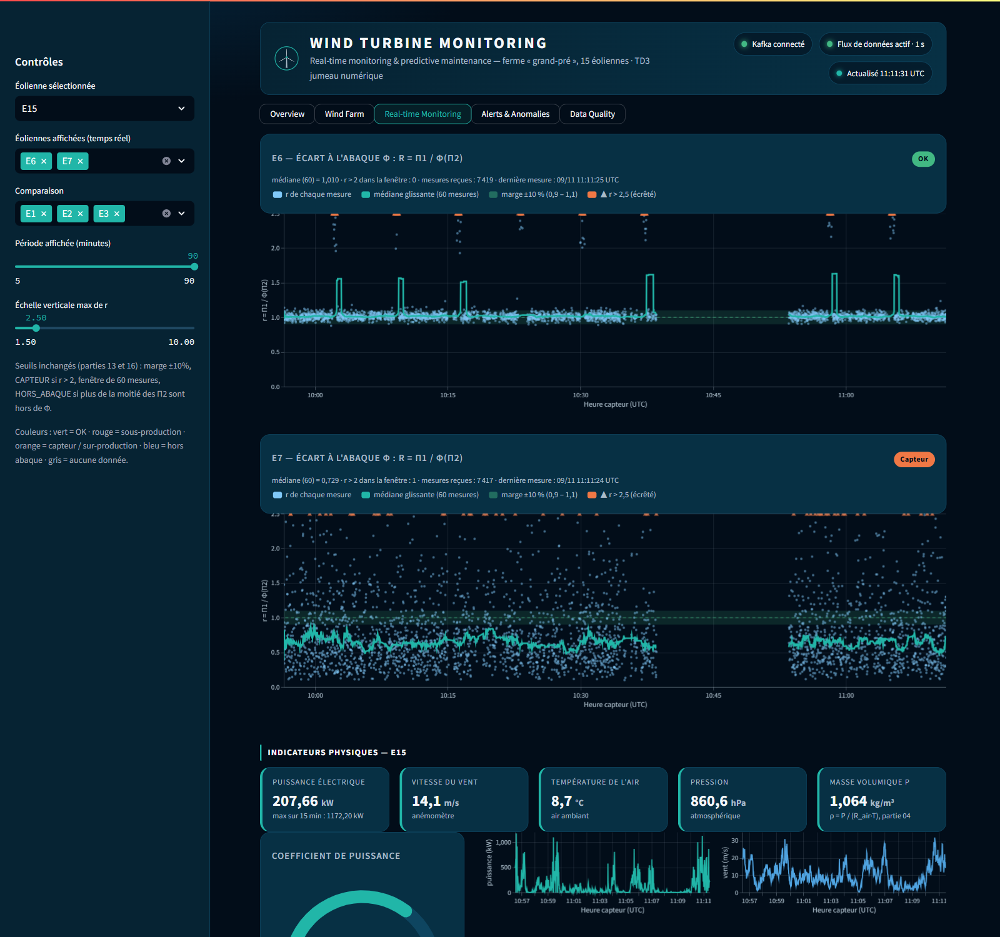

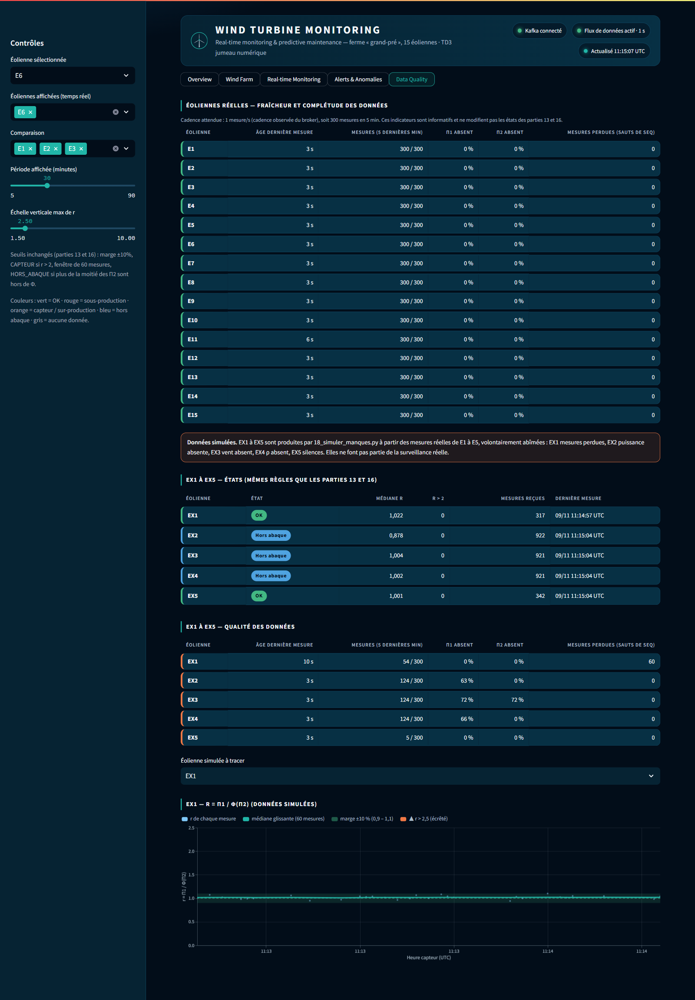
